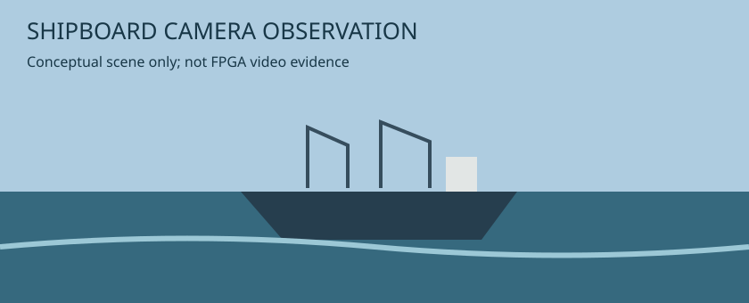
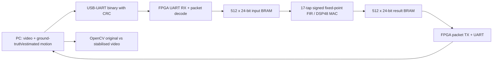

# FPGA Maritime Video Stabilisation & Audio Noise Reduction

**Current status:** The existing CLI-controlled FIR/UART implementation passed physical Arty A7-35T verification on COM4 (17 November 2026, user-provided logs). **The new interactive GUI is a separate development candidate awaiting local hardware GUI testing.** This independent Artix-7 / SystemVerilog / Python demonstrator uses a real FPGA **17-tap motion FIR** to smooth camera-motion trajectories, while OpenCV renders the corrected image frames on the host. A separate audio filtering extension is planned; audio is **not** implemented in this release.

**Start here:** [Fresh integration and Windows setup](docs/INTEGRATION_STATUS.md) · [Why videos can look unchanged](docs/VIDEO_STABILISATION_DIAGNOSTICS.md)




*Both diagrams are conceptual, not FPGA output.*


> **v0.6 interface redesign — candidate:** High-DPI Windows text rendering, larger Segoe UI labels, resizable video/analysis workspace, enlarged plot tabs, separate full-size engineering dashboard, and a formatted Help guide with A+/A− text controls. All existing FPGA RTL, XDC constraints, UART protocol and bitstream scripts are unchanged. The design was desktop-smoke-tested and the **30/30 existing host tests passed** in this environment. **The redesigned GUI still requires testing on the physical Windows/Arty A7 setup.**


*GUI design screenshot. Empty initial state; no physical result asserted.*

[View the v0.6 expanded software-only engineering dashboard](docs/screenshots/gui_v06_expanded_software_preview.jpg) · [View the new operator guide](docs/screenshots/gui_v06_help.jpg) · [Read the v0.6 UI guide](docs/GUI_DESIGN_V06.md).

> **v0.5 natural-footage release candidate:** [Real Footage Validation Guide](docs/REAL_FOOTAGE_VALIDATION.md) · [v0.5 Changelog](CHANGELOG_GUI_V05.md). GUI import now **preserves naturally recorded camera motion**, does not inject shake or supply a motion CSV, and evaluates **independent image-based stability** in addition to the FIR trajectory. This software upgrade has **26/26 host tests PASS** and desktop smoke PASS; the updated GUI has **not** been reverified against your physical FPGA, and no naturally shaky real clip has yet satisfied the real-footage release gate. The previously validated bitstream is unchanged.

## Interactive laptop demonstrator — GUI v0.6 (natural camera shake)

The Windows desktop GUI supports **File → Open video** (30 fps, 18–496 frames, up to 1280×720), **Import natural footage** (no injected motion or CSV) or separate synthetic tests, physical FPGA COM-port selection (COM4 on the tested workstation), a real 3-case hardware self-test, and **side-by-side synchronized video playback in the same window**, with motion curves, spectra, shake-reduction metrics and evidence exports.

```powershell
python -m pip install -r .\host\requirements.txt
powershell -ExecutionPolicy Bypass -File .\scripts\run_gui_tests.ps1
powershell -ExecutionPolicy Bypass -File .\scripts\launch_maritime_gui.ps1
```

See [Interactive GUI Demonstrator](docs/INTERACTIVE_GUI_DEMONSTRATOR.md). The physical board top has BTN0 reset; the GUI's **Reset view** does not reset the board. Existing v0.2 bitstream may be reused. For actual video motion estimation, OpenCV on the PC supplies samples to the **physical FPGA FIR**; no image pixels are sent to the FPGA. Software preview and real hardware execution are separately labelled.

**GUI physical hardware testing on Windows remains pending** even though previous CLI hardware smoke/video validation on COM4 passed. Real recorded video outcome may be positive, negative or inconclusive.

## Architecture



The FPGA handles **24-bit motion samples, not pixels**, and video runs offline in buffered jobs. This is not a video-input, live stabilisation or tracking system. The planned fixed FIR processes one trajectory axis at a time. An independent FPGA sample comparison is required before the host may label results as **PHYSICAL FPGA - BIT-EXACT VERIFIED**.

## Included

- `rtl/`: standalone Arty A7-35T board top, UART receiver/transmitter, request parser/response serializer with CRC16, synchronous sample RAM, FIR batch controller and the original signed 17-tap MAC.
- `tb/`: complete UART-to-FIR UART regression with valid impulse, CRC rejection and post-error recovery, alongside core regression.
- `host/`: reproducible synthetic maritime footage, bit-exact Python reference, CRC protocol, pyserial hardware client, and video comparison software.
- `constraints/`: official Digilent Arty A7-35T pin assignments for 100 MHz clock, USB-UART, reset button and four LEDs.
- `scripts/`: single-step Vivado board project, synthesis/bitstream script, XSim and Icarus regressions.
- `docs/`: [master plan](docs/MASTER_PLAN.md), [UART protocol](docs/PROTOCOL.md), [board build procedure](docs/BOARD_INTEGRATION.md) and [software demo instructions](host/GETTING_STARTED.md).

## First run (software demo)

```powershell
python -m pip install -r host/requirements.txt
python -m pytest -q tests/test_fixed_point.py tests/test_serial_protocol.py tests/test_synthetic_maritime.py
python host/stabilize_video.py --out build/maritime_demo
```

This creates `build/maritime_demo/software_preview_before_after.mp4` (labelled **SOFTWARE REFERENCE ONLY**), trajectory CSV and `metrics.json`. Do not present these metrics as FPGA hardware results.

## Full RTL regression (Vivado XSim on Windows)

```powershell
$env:PATH = "C:\AMDDesignTools\2025.2.1\Vivado\bin;$env:PATH"
powershell -ExecutionPolicy Bypass -File .\scripts\run_maritime_xsim.ps1
```

Look for `MARITIME_UART_FIR_REGRESSION_PASS`. This tests actual serial bits and FIR processing in the RTL, not just Python.

## One-command local validation and Vivado board build

Close Vivado GUI, then run:

```powershell
powershell -ExecutionPolicy Bypass -File .\scripts\run_all_local.ps1
```

This runs Python tests, complete UART/FIR XSim regression, a software-only maritime preview, then synthesis/implementation and bitstream. The local script **does not claim physical hardware success**. Run `python host/hardware_smoke.py --port COM4` after flashing the bitstream (COM4 was the working port in the observed test; verify it when reconnecting).

## Vivado board build and programming

**Close the Vivado GUI**, then run:

```powershell
& "C:\AMDDesignTools\2025.2.1\Vivado\bin\vivado.bat" -mode batch -source scripts/build_maritime_bitstream.tcl
```

Examine the DRC, resource and routed timing reports before programming. Open `build/vivado_maritime_a7/maritime_a7.xpr` to inspect RTL hierarchy and synthesized schematic. See [board integration guide](docs/BOARD_INTEGRATION.md) for actual COM-port testing. A user-provided local Vivado 2025.2.1 run has shown bitstream generation and physical UART/FIR success. The updated GUI v0.5 has not yet been verified with hardware.

```powershell
python host/stabilize_video.py --out build/maritime_demo --port COM4
```

Replace `COM4` if Windows assigns your Arty UART a different COM port. The host aborts if any FPGA returned sample disagrees with the bit-exact model. **The physical CLI hardware test has passed on COM4; future GUI runs still require their own verification.**

## Next releases

- `v1.0`: hardware-verified maritime camera-motion smoothing, timing and resource reports, before/after video.
- `v1.1`: independent buffered 16 kHz audio FIR demonstration.
- `v1.2`: synchronized audio/video demonstration.

The project is intended as a **self-contained reproducible engineering portfolio** with source, benchmarks and provenance. Licensed under the MIT License; independent third-party dependencies retain their own terms.

## Natural maritime footage + Help (GUI v0.5)

**The primary test now requires natural camera movement recorded at sea.** Open **Import natural footage…** and select the original video; the app takes up to five seconds, standardises to 30 fps, and preserves the source's real motion. No synthetic shake or hand-entered motion CSV is added in this mode.

The GUI's **Help / Steps** menu explains board programming, COM-port detection, all controls, actual OpenCV-to-FPGA processing and validation. Read the [real-footage engineering validation plan](docs/REAL_FOOTAGE_VALIDATION.md) before making performance claims. The GUI reports both FIR trajectory smoothing and a **separate, quality-gated image-content movement result**. A clip that cannot be measured may show `INCONCLUSIVE` rather than a fabricated improvement.

The tool does not bundle a third-party recording or claim that a natural shake test has passed. Suggested independent sources include [ViCoS MODD2](https://data.vicos.si/borja/viamaro/index.html) and [Wikimedia OOI vessel-mounted videos](https://commons.wikimedia.org/wiki/Category:Ocean_Observatories_Initiative_videos), subject to source-specific permissions and actual visible camera shake.
