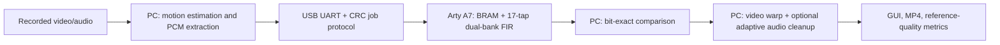
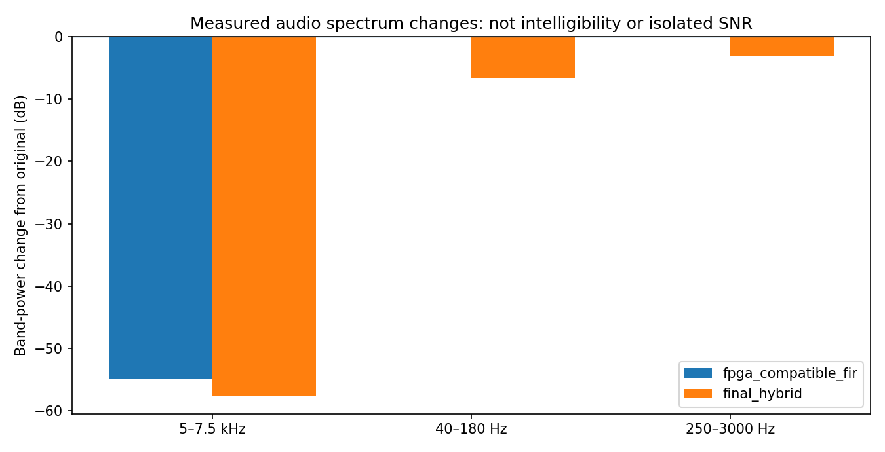
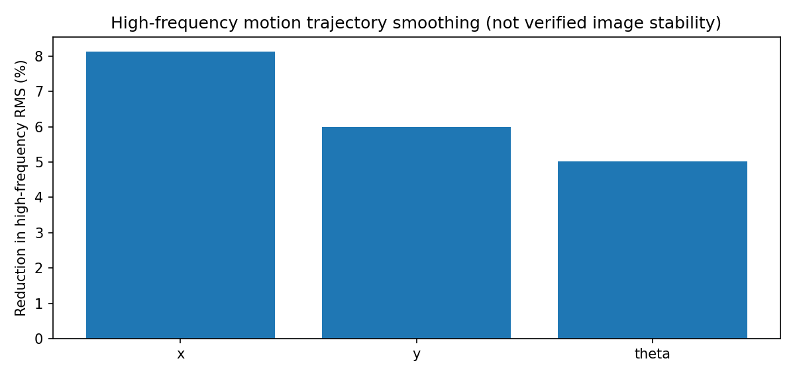

**Test media update (23 November 2026):** Four original AI-generated maritime MP4 test clips have been prepared for the [`videos/` folder](videos/README.md), with SHA-256 hashes and [reproduction instructions](docs/VIDEO_TEST_MEDIA.md). This commit updates source-control rules and documentation; the binary files themselves require a separate upload from the downloadable media bundle. These clips are not actual sea-trial recordings; the source-code MIT licence does not by itself establish commercial rights to third-party-generated video/voice content.

**RevI release evidence update (23 November 2026):** Archived 36 actual XADC snapshots (31.6–32.4°C), differentiated from vectorless power estimates and from the successful 15-minute reliability campaign. Repo package includes selected source-safe evidence without private absolute paths. See [XADC evidence](evidence/xadc_2026-11-23/README.md).

**RevH host-only documentation/UI update:** Video Assessment now includes a five-row Normal/Strong table (software-reference provenance), and Help → Testing & commands shows copyable commands maintained in [the verification guide](docs/TEST_AND_VERIFICATION_COMMANDS.md). RTL/XDC unchanged; no new bitstream is required.

# FPGA-Based Maritime Video Stabilisation & Audio Noise Reduction

**Digilent Arty A7-35T · Artix-7 · SystemVerilog · Vivado 2025.2.1 · 17-tap FIR · UART/CRC · Python/OpenCV · quantitative evidence**

A standalone FPGA/host engineering demonstrator for *recorded* maritime video and
audio. A single **resource-shared FPGA FIR engine** accepts buffered 24-bit
fixed-point X/Y/roll camera-motion trajectories or 16-kHz mono PCM sample jobs
through USB-UART. Independent signed Q1.15 coefficient banks select the camera
motion and speech-band filters. The PC performs motion estimation, OpenCV
frame warping, the optional adaptive spectral audio stage, playback and MP4
rendering. **This is not a full-frame video FPGA or real-time audio system.**

**RevG — host usability & stabilisation diagnostics (23 November 2026):**
Added stage-wise GUI progress, cooperative cancellation between complete UART
packets, host FFmpeg cancellation/recovery, and a **Compare Normal / Strong**
action on Video Assessment. The same three-second clip shows stronger
**trajectory smoothing** with the existing two-pass mode, at a small crop
cost; independent image-content stability is still **INCONCLUSIVE**. No RTL,
Vivado constraints or bitstream changes. See
[RevG processing and profile comparison](docs/GUI_REVG_PROGRESS_AND_PROFILE_COMPARISON.md).

**Measured XADC evidence:** 36 operator-supplied Vivado Hardware Manager
snapshots (14 idle, 20 post-processing, 2 historical `soak_end` labels) range
**31.6–32.4°C**, with latest 32.2°C. These are discrete post-processing/idle
readings, **not continuous peak temperature or controlled thermal qualification**.
The 0.071 W reported for Vivado is a vectorless *power estimate*, not a
measured electrical-power value. See [the archived measured CSV](evidence/xadc_2026-11-23/README.md). The
JTAG-read method is distinct from the 0.071 W vectorless power estimate.

**GUI usability update (RevF, 23 November 2026):** One navigation strip only:
Implementation, Video Assessment, Audio Assessment, Summary Report and Help.
The duplicate menu-bar navigation has been removed; a small **Tools** control
on the Implementation tab holds specialist import/lab actions and the XADC
sampling guide. Audio cleanup is a visible selector on the Implementation tab.
The Summary Report distinguishes **measured XADC die temperature** from
estimated power, and remains **NOT MEASURED** until real hardware snapshots
are imported. See [XADC capture instructions](docs/XADC_DIE_TEMPERATURE.md).

**Engineering evidence update: 23 November 2026.** The owner's RevD Vivado build
and physical FPGA verification are complete. The source-tree/report/GUI changes
in this release have **not changed the verified RTL or XDC** and therefore do
**not** require another synthesis, implementation or bitstream. See the evidence
and outstanding limitations in [Engineering Release Review](docs/ENGINEERING_RELEASE_2026-11-23.md).

## Verified FPGA implementation and board evidence

| Review dimension | Result | Source/qualification |
|---|---:|---|
| System clock | 100 MHz | RevD post-route, 23 Nov |
| Setup WNS / TNS | **+1.740 / 0.000 ns** | Internally constrained timing only |
| Hold WHS / THS | **+0.046 / 0.000 ns** | Internally constrained timing only |
| Resources | 632 LUT / 857 FF | One DSP48E1, two RAMB18, eight I/O |
| FPGA power | **0.071 W estimated** | Vectorless routed estimate; *not* board watts |
| Motion + audio FIR bit exactness | **PASS** | Owner's Arty A7 COM4 log, 48k audio samples in 97 jobs |
| Reset reliability | **80/80 jobs** | Ten operator button-reset cycles |
| Cold reliability | **40/40 jobs** | Five manually performed cycles |
| Warm workload, successful retest | **4,408/4,408 jobs** | 15-minute soak; no elevated-temperature claim |
| Earlier soak attempt | **4,523 pass / 141 fail** | Host COM4 permission conflict; preserved, not erased |

**DRC:** No `REQP-1840` or `CFGBVS-1` in the latest report; `DPIP-1` ×2 and
`DPOP-1` ×1 remain advisory. External UART/button/LED timing exceptions and
vectorless power assumptions remain review items. Physical bitstream identity
was not independently interrogated; passing clean soak is screenshot-evidenced
until local raw logs are imported.

## Architecture and verification levels



| Level | Location | Main checks |
|---|---|---|
| **1. Mathematical/software** | `verification/model/` | DC, impulse, Q-format extremes, frequency response, model output |
| **2. RTL simulation** | `hardware/sim/` | FIR vectors, UART/CRC, reset and coefficient-bank switching |
| **3. Integrated system** | `verification/system/` | GUI/media, physical UART FIR verification, reset/cold/soak, audiovisual quality |

**Only one Vivado project** is shipped: `hardware/build/maritime_a7.xpr`.
Generated `.runs/.gen/.cache`, reports and bitstreams live under
`hardware/build/` after local implementation; they are excluded from GitHub
source. The companion `hardware/vivado/` holds reproducible Tcl.

## Actual audiovisual effectiveness: important distinction

The supplied three-second example, analysed using the local **software
reference model** (not re-run through the board), shows high-frequency motion
trajectory smoothing of **8.14% X, 5.99% Y, 5.02% roll**, with **92.46% image
area retained**. Independent image-content stability was **INCONCLUSIVE** due
to insufficient background texture; visibly improved stabilisation is **not
established** for this example.

Audio response on the same clip: the FIR-only model reduced 5–7.5 kHz band
power by **54.94 dB**, with −0.09 dB change to the 250–3000 Hz band. The
FIR-plus-**host** adaptive stage reduced that high band by **57.60 dB**,
40–180 Hz by **6.66 dB**, and the speech band by **3.07 dB**. These are band
energy differences, not a measured speech-intelligibility or isolated-SNR gain.





See [Media Quality Review](docs/MEDIA_QUALITY_2026-11-23.md) for detailed
provenance and how to recreate the assessment from a **physical** processed
media output.

## Reproduce and explore (Windows)

In a new folder with Python dependencies installed:

```powershell
python -m pip install -r .\host\requirements.txt
powershell -ExecutionPolicy Bypass -File .\scripts\run_engineering_assessment.ps1
powershell -ExecutionPolicy Bypass -File .\scripts\launch_maritime_gui.ps1
```

The GUI has Implementation, Video Assessment, Audio Assessment, Summary Report
and Help views. **Summary Report** includes the latest routed report metrics,
physical reset/cold/soak *history* (including previous failure), filter model,
and stage-labelled visual/audio quality metrics. The **Quality charts** button
shows sample-reference plots; **Refresh evidence** picks up newer local test
logs without altering the FPGA.

To inspect the existing project in Vivado, open:

`hardware/build/maritime_a7.xpr`

Or regenerate the same source-backed project:

```powershell
powershell -ExecutionPolicy Bypass -File .\OPEN_VIVADO_PROJECT_WINDOWS.ps1 -Recreate
```

Run XSim on Windows via scripts under `hardware/sim/scripts/`. A fresh full
Vivado run is **optional for this host/report update**, but required if you
change FPGA RTL, timing constraints, device or coefficients.

To import original physical results into a fresh local extract:

```powershell
powershell -ExecutionPolicy Bypass -File .\scripts\import_local_validation_evidence.ps1 -PreviousProjectRoot 'C:\...\FPGA_Maritime_AV_7'
```

This preserves the first failed soak and recognises the later passing run by
its own evidence folder. To remeasure processing quality on your *own* audio/
video output, use `scripts/run_media_quality.ps1 -RunDir <completed_run_folder>`.

For project setup and board commands, see [START_HERE_WINDOWS.txt](START_HERE_WINDOWS.txt).

## Repository hygiene

Source hierarchy: `hardware/`, `host/`, `verification/`, `scripts/`, `docs/`,
`evidence/`, `videos/`, `media_sources/`. Raw local report archives, serial
transcripts, FPGA bitstreams, and redistribution-uncertain video clips are
**not part of the GitHub source staging set**. The private/local ZIP can carry
a separate evidence archive.

GitHub staging instructions and publication safeguards:
[GitHub Release Checklist](docs/GITHUB_RELEASE_CHECKLIST.md). The existing
repository and history should remain intact; changes go to a dedicated branch,
not directly to `main`.

**Scope disclaimer:** prototype DSP verification, not product certification,
real-time system performance, measured board power, or verified speech quality.
