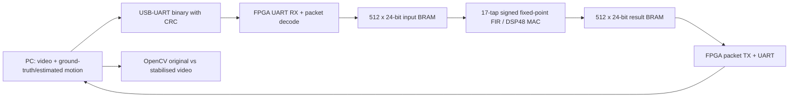

# FPGA Maritime Video Stabilisation & Audio Noise Reduction

**Current development release v1.1 (20 November 2026):** Two-stage maritime audio cleanup (FPGA-verifiable audio FIR followed by **CPU-only adaptive spectral noise suppression**); four GUI tabs: Implementation, Video Assessment, Audio Assessment, Help. See [v1.1 implementation and validation](docs/MARITIME_ADAPTIVE_AUDIO_V11.md). Existing dual-bank bitstream remains compatible. Hardware does not perform the optional adaptive stage.

**Previous GUI milestone v1.0.2:** The in-app Play/Replay button now plays the selected soundtrack while the video frames advance together. The playback row has `Audio: Original / Filtered / Mute`. Before processing, Original is used; after combined processing, Filtered is selected by default. Pause and scrubbing stop the sound, and Replay restarts it. One soundtrack is selected at a time because the side-by-side comparison has two images but one speaker output. `Play MP4 with audio` still launches the saved MP4 externally. Windows playback now prefers PortAudio and falls back to MCI; other operating systems should use the external media player. This is **completed-file playback**; the FPGA is not streaming audio to the speakers. The Windows sound driver still needs a local test.

**Historical unified audiovisual milestone v1.0.** The Windows GUI now accepts a single MP4 and can run **Video + Audio** or **Video only** from the same three-tab interface. Combined mode produces `final_stabilised_filtered_audio.mp4` (stabilised picture + 3.2 kHz speech-band filtered soundtrack), a side-by-side comparison, original/filtered WAVs and independent video/audio measurements. **These were v1.0 software-only results; the short physical dual-bank demonstration was subsequently verified on 20 November 2026.** The existing 30 fps motion coefficient bank and 16 kHz speech coefficient bank are independent jobs in the same shared FIR arithmetic engine. To run hardware combined processing, build/program the new v0.9+ dual-bank bitstream first. See [unified architecture and verification](docs/UNIFIED_AV_V10.md). 


**Historical audio DSP milestone v0.9:** A new signed Q1.15 **16 kHz speech-band FIR coefficient bank** can be selected using UART Job ID bit 7, preserving the 30 fps motion filter. A Windows audio-processing dialog under **File → Audio noise reduction**, audio A/B WAV playback, waveform/spectrum graphs, and short MP4 exports are implemented as a development candidate. **A new Vivado bitstream and physical COM4 audio test are REQUIRED** before FPGA-backed audio processing can be called verified. Existing video GUI remains three tabs. See [audio architecture and validation](docs/AUDIO_PHASE_V09.md).

**GUI v0.8.2 development:** Source videos in `videos/`, results separated into `videos/sim/` and `videos/hrd/`, explicit Assessment provenance, long-input FIR chunking, and audio-preserving output. See [GUI v0.8.2 guide](docs/GUI_V082_LONG_VIDEO_AUDIO.md).

**v0.8.1 GUI CANDIDATE (20 November 2026):** Three main tabs (**Implementation**, **Assessment**, **Help**); one compact action row; maximised side-by-side video workspace; and full-height selectable analytical plots. **38/38 host tests PASS locally (including 3 playback tests); GUI desktop smoke and software-preview render PASS. Physical v0.8 GUI-to-Arty A7 test remains pending.** The FPGA RTL, coefficient ROM and Vivado bitstream workflow are unchanged.

**Historical v0.8/v0.9 status:** The existing CLI-controlled FIR/UART implementation passed physical Arty A7-35T verification on COM4 (17 November 2026, user-provided logs). **The new interactive GUI is a separate development candidate awaiting local hardware GUI testing.** This independent Artix-7 / SystemVerilog / Python demonstrator uses a real FPGA **17-tap motion FIR** to smooth camera-motion trajectories, while OpenCV renders the corrected image frames on the host. A software-tested dual-bank audio extension is now available in a separate v1.0 development candidate.

**Three-axis foundation introduced in v0.7:** [Three-axis geometry, validation, limitations and Windows commands](docs/THREE_AXIS_V07.md). The older `integration-v0.6`, `feature/three-axis-v0.7`, and `feature/gui-three-tabs-v0.8` branches remain rollback baselines; use the v0.8.1 playback-fix branch for this candidate.

**Start here:** [Fresh integration and Windows setup](docs/INTEGRATION_STATUS.md) · [Why videos can look unchanged](docs/VIDEO_STABILISATION_DIAGNOSTICS.md)


*Both diagrams are conceptual, not FPGA output.*


## GUI v0.8.1 — playback usability fix

Original videos are now playable immediately on upload (before filtering). After processing, both panels replay together repeatedly. Seek/pause/reset and source switching are covered by dedicated desktop tests. This is a GUI-only update with **no new bitstream needed**. See [playback tests and behaviour](docs/GUI_PLAYBACK_V081.md).

## Historical GUI v0.8 — three-tab operator workspace

The interface keeps primary actions in one compact row and gives the rest of **Implementation** to the original/stabilised videos. **Assessment** has a dedicated large plot: motion curves (select X/Y/ROLL), spectrum, independent image stability, or evidence log. **Help** is a readable in-app guide including Vivado programming, connection testing, and the smoothing profiles.


[Detailed v0.8 UI design and test limits](docs/GUI_DESIGN_V08.md) · [v0.8 changelog](CHANGELOG_GUI_V08.md)

> **v0.5 natural-footage release candidate:** [Real Footage Validation Guide](docs/REAL_FOOTAGE_VALIDATION.md) · [v0.5 Changelog](CHANGELOG_GUI_V05.md). GUI import now **preserves naturally recorded camera motion**, does not inject shake or supply a motion CSV, and evaluates **independent image-based stability** in addition to the FIR trajectory. This software upgrade has **26/26 host tests PASS** and desktop smoke PASS; the updated GUI has **not** been reverified against your physical FPGA, and no naturally shaky real clip has yet satisfied the real-footage release gate. The previously validated bitstream is unchanged.

## Interactive laptop demonstrator — GUI v0.8 (natural camera shake and roll)

The Windows desktop GUI now supports **three-axis X/Y/roll compensation** with **Normal/Strong FIR modes** and fixed image cropping. **Implementation** includes File → Open video (30 fps, 18–496 frames, up to 1280×720), COM-port selection, connection testing, FPGA stabilisation and a full-size before/after player. For original footage preparation or synthetic lab input, use the **File** menu. **Assessment** and **Help** are separate main tabs. Normal applies one FIR pass per axis; Strong applies two, which can increase both suppression and crop loss.

```powershell
python -m pip install -r .\host\requirements.txt
powershell -ExecutionPolicy Bypass -File .\scripts\run_gui_tests.ps1
powershell -ExecutionPolicy Bypass -File .\scripts\launch_maritime_gui.ps1
```

See [Interactive GUI Demonstrator](docs/INTERACTIVE_GUI_DEMONSTRATOR.md). The physical board top has BTN0 reset; the GUI's **Reset view** does not reset the board. Existing v0.2 bitstream may be reused. For actual video motion estimation, OpenCV on the PC supplies samples to the **physical FPGA FIR**; no image pixels are sent to the FPGA. Software preview and real hardware execution are separately labelled.

**GUI physical hardware testing on Windows remains pending** even though previous CLI hardware smoke/video validation on COM4 passed. Real recorded video outcome may be positive, negative or inconclusive.

## Architecture



The FPGA handles **24-bit motion samples, not pixels**, and video runs offline in buffered jobs. This is not a video-input, live stabilisation or tracking system. The planned fixed FIR processes one trajectory axis at a time. An independent FPGA sample comparison is required before the host may label results as **PHYSICAL FPGA - BIT-EXACT VERIFIED**.

## Included

- `rtl/`: standalone Arty A7-35T board top, UART receiver/transmitter, request parser/response serializer with CRC16, synchronous sample RAM, FIR batch controller and the original signed 17-tap MAC.
- `tb/`: complete UART-to-FIR UART regression with valid impulse, CRC rejection and post-error recovery, alongside core regression.
- `host/`: reproducible synthetic maritime footage, bit-exact Python reference, CRC protocol, pyserial hardware client, and video comparison software.
- `constraints/`: official Digilent Arty A7-35T pin assignments for 100 MHz clock, USB-UART, reset button and four LEDs.
- `scripts/`: single-step Vivado board project, synthesis/bitstream script, XSim and Icarus regressions.
- `docs/`: [master plan](docs/MASTER_PLAN.md), [UART protocol](docs/PROTOCOL.md), [board build procedure](docs/BOARD_INTEGRATION.md) and [software demo instructions](host/GETTING_STARTED.md).

## First run (software demo)

```powershell
python -m pip install -r host/requirements.txt
python -m pytest -q tests/test_fixed_point.py tests/test_serial_protocol.py tests/test_synthetic_maritime.py
python host/stabilize_video.py --out build/maritime_demo
```

This creates `build/maritime_demo/software_preview_before_after.mp4` (labelled **SOFTWARE REFERENCE ONLY**), trajectory CSV and `metrics.json`. Do not present these metrics as FPGA hardware results.

## Full RTL regression (Vivado XSim on Windows)

```powershell
$env:PATH = "C:\AMDDesignTools\2025.2.1\Vivado\bin;$env:PATH"
powershell -ExecutionPolicy Bypass -File .\scripts\run_maritime_xsim.ps1
```

Look for `MARITIME_UART_FIR_REGRESSION_PASS`. This tests actual serial bits and FIR processing in the RTL, not just Python.

## One-command local validation and Vivado board build

Close Vivado GUI, then run:

```powershell
powershell -ExecutionPolicy Bypass -File .\scripts\run_all_local.ps1
```

This runs Python tests, complete UART/FIR XSim regression, a software-only maritime preview, then synthesis/implementation and bitstream. The local script **does not claim physical hardware success**. Run `python host/hardware_smoke.py --port COM4` after flashing the bitstream (COM4 was the working port in the observed test; verify it when reconnecting).

## Vivado board build and programming

**Close the Vivado GUI**, then run:

```powershell
& "C:\AMDDesignTools\2025.2.1\Vivado\bin\vivado.bat" -mode batch -source scripts/build_maritime_bitstream.tcl
```

Examine the DRC, resource and routed timing reports before programming. Open `build/vivado_maritime_a7/maritime_a7.xpr` to inspect RTL hierarchy and synthesized schematic. See [board integration guide](docs/BOARD_INTEGRATION.md) for actual COM-port testing. A user-provided local Vivado 2025.2.1 run has shown bitstream generation and physical UART/FIR success. The updated v0.8 GUI has not yet been verified with hardware.

```powershell
python host/stabilize_video.py --out build/maritime_demo --port COM4
```

Replace `COM4` if Windows assigns your Arty UART a different COM port. The host aborts if any FPGA returned sample disagrees with the bit-exact model. **The physical CLI hardware test has passed on COM4; future GUI runs still require their own verification.**

## Next releases

- `v1.0`: hardware-verified maritime camera-motion smoothing, timing and resource reports, before/after video.
- `v1.1`: independent buffered 16 kHz audio FIR demonstration.
- `v1.2`: synchronized audio/video demonstration.

The project is intended as a **self-contained reproducible engineering portfolio** with source, benchmarks and provenance. Licensed under the MIT License; independent third-party dependencies retain their own terms.

## Natural maritime footage + Help (GUI v0.5)

**The primary test now requires natural camera movement recorded at sea.** Open **Import natural footage…** and select the original video; the app takes up to five seconds, standardises to 30 fps, and preserves the source's real motion. No synthetic shake or hand-entered motion CSV is added in this mode.

The GUI's **Help / Steps** menu explains board programming, COM-port detection, all controls, actual OpenCV-to-FPGA processing and validation. Read the [real-footage engineering validation plan](docs/REAL_FOOTAGE_VALIDATION.md) before making performance claims. The GUI reports both FIR trajectory smoothing and a **separate, quality-gated image-content movement result**. A clip that cannot be measured may show `INCONCLUSIVE` rather than a fabricated improvement.

The tool does not bundle a third-party recording or claim that a natural shake test has passed. Suggested independent sources include [ViCoS MODD2](https://data.vicos.si/borja/viamaro/index.html) and [Wikimedia OOI vessel-mounted videos](https://commons.wikimedia.org/wiki/Category:Ocean_Observatories_Initiative_videos), subject to source-specific permissions and actual visible camera shake.

### Post-processing GUI sound recovery (v1.0.4 candidate)

On Windows, the embedded video player's audio backend now prefers PortAudio (`sounddevice`) for original/filtered WAV playback after processing and falls back to Windows MCI. The selected track, backend and errors appear in the status/log. See [playback recovery and Windows checks](docs/GUI_AUDIO_PLAYBACK_V104.md). This is GUI-only; it does not change FPGA arithmetic or require a new bitstream.
