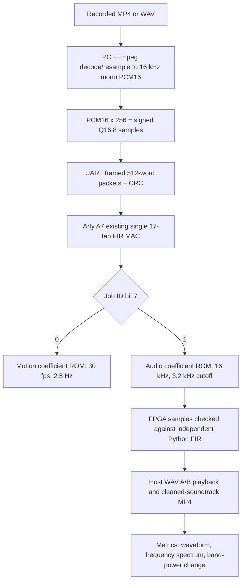

# Audio FIR extension — v0.9 development candidate

**Status (20 November 2026):** Host-side audio software reference tested; 53/53 local Python tests pass, and the [dual-bank UART/FIR GitHub integration CI](https://github.com/msamie-elec/FPGA-maritime-motion-audio-dsp/actions/runs/44757024215) and standalone FIR CI both PASS. **Local Vivado synthesis, XSim, routed timing, and physical COM4 audio processing remain unverified.** The current working v0.8.2 video branch is preserved in GitHub `main`.

## Why the previous video interface was silent

The GUI's built-in Tk/OpenCV video playback displays images without a sound engine. v0.8.2 already preserved the original audio stream in exported MP4s, playable through **Play MP4 with audio** in Windows. v0.9 adds an explicit **File → Audio noise reduction** dialog: on Windows, the WAV playback buttons use `winsound` to play actual audio through the laptop's speakers. Video/voice synchronised playback in the embedded GUI remains future work.

## Goal and boundaries

Demonstrate fixed-point FIR filtering of recorded speech in the same Arty A7 that filters camera motion, allowing audio/video comparisons in a coherent portfolio. This first audio milestone focuses on attenuating **high-frequency hiss outside much of the speech band**. A low-pass FIR **cannot** selectively separate engine/wind noise that overlaps speech frequencies; it may reduce useful fricative sounds. Neither band-power reduction nor bit-exact FPGA arithmetic proves higher speech intelligibility.

**No audio ADC, external codec, microphone capture or live processing is introduced**. The PC uses FFmpeg to read WAV/MP4 audio, quantises samples and sends buffered batches to the FPGA over 115200 baud USB-UART, as it already does for motion data. A fresh v0.9 bitstream is required for hardware audio.

## Architecture



The job high bit selects coefficients **before multiplication** in the same single MAC: no extra parallel multiplier is specified by RTL. Actual DSP48E1 count and timing must be checked in Vivado. Video X/Y/roll jobs remain low IDs and retain the original coefficients.

### FIR design

- Audio sample rate **16,000 Hz**, mono, signed PCM16 on the host.
- Audio filter: **17 taps**, 3,200 Hz Hamming-window low pass, Q1.15 signed ROM, symmetric, unity DC gain (32,768 exactly).
- 24-bit sample input/output: PCM16 shifted left by 8 bits to Q16.8; existing 40-bit product, 48-bit accumulator and arithmetic right-shift by 15.
- Comparison: each returned **24-bit** FPGA sample must exactly match Python fixed point before converted WAV is labelled hardware verified.
- Buffered overlap: maximum 496 new samples per 512-word job (eight neighbours each side), response indices `[16:16+n]`, continuous centered convolution across packet boundaries.
- `AUDIO_JOB=0x81`, using the existing request/response format and CRC. Motion uses IDs below 0x80.
- At **115200 baud**, this exchange is substantially slower than realtime 16 kHz audio; expect hardware elapsed times significantly longer than media duration. Benchmark on the actual Windows setup.

### Files added

- `rtl/audio_coefficients.svh`, `rtl/audio_coefficients.txt`: deterministic audio coefficient bank.
- `host/design_audio_coefficients.py`: reproducible coefficient generator.
- `host/audio_dsp.py`: FFmpeg PCM input, software/physical audio FIR job, WAV, A/B, waveform/spectrum, MP4 audio replacement, provenance.
- `tests/test_audio_fir_v09.py`: fixed-point/serial-boundary/negative/audio-export regression.
- `scripts/run_audio_demo.ps1`: short independent demo command.
- `host/maritime_gui.py`: File → Audio noise reduction; interactive input, audio previews, COM port and explicit hardware requirement.
- Modified `rtl/fir_sequential.sv`, `rtl/fir_job_controller.sv`, `rtl/arty_a7_maritime_top.sv`: bank-selection plumbing.
- Modified `tb/tb_maritime_uart_top.sv`: extra audio impulse and mode-switching tests.

## Running without FPGA — ready now

```powershell
python -m pip install -r .\host\requirements.txt
powershell -ExecutionPolicy Bypass -File .\scripts\run_gui_tests.ps1
powershell -ExecutionPolicy Bypass -File .\scripts\launch_maritime_gui.ps1
```

In the GUI choose **File → Audio noise reduction**, select an MP4/WAV source (e.g. your prepared `videos/02_Maritime_Long_30s_With_Audio.mp4`), choose **start 0, duration 4 s**, click **Software audio preview**, and listen via **Original / Filtered / A/B**. On Windows, those buttons use the built-in `winsound` WAV player. The audio dialog works separately from the silent video-frame display.

CLI alternative:

```powershell
powershell -ExecutionPolicy Bypass -File .\scripts\run_audio_demo.ps1 -Source .\videos\02_Maritime_Long_30s_With_Audio.mp4 -Seconds 4
```

Exports per run: `audio_original.wav`, `audio_filtered.wav`, `audio_AB_compare.wav`, `audio_analysis.png`, `audio_metrics.json`, `AUDIO_RUN_REPORT.md`, and for MP4 sources `video_filtered_audio.mp4`. Folder: `videos/sim/…` for software; `videos/hrd/…` only after physical FPGA runs.

## Physical FPGA verification — pending

1. In a **fresh checkout** of this v0.9 branch, run GUI regression and the full UART/FIR XSim simulation. CI should run both bank-selection impulse tests.
2. **Close the Vivado GUI** if writing to the same generated project; build the new design:

   ```powershell
   & "C:\AMDDesignTools\2025.2.1\Vivado\bin\vivado.bat" -mode batch -source scripts/build_maritime_bitstream.tcl
   ```

3. Examine routed DSP/LUT/FF/BRAM/timing/DRC reports; ensure 100 MHz and no new unacceptable warnings.
4. Program the newly built `arty_a7_maritime_top.bit`. The **older v0.8.2 bitstream does not have the audio bank**.
5. Select the actual Arty A7 COM port (previously COM4), run video/motion verification, then in the audio dialog run **Process on FPGA**. The new audio job uses 0x81.
6. Retain first bit-exact hardware WAV, metrics, and timing. Do not call it a physical FPGA audio success before this is observed.

## Performance interpretation and next milestone

The controlled mixture of 1 kHz desired tone plus 6 kHz interference showed >50 dB high-band reduction and near-zero 250–3,000 Hz band-power change in software. A four-second sample from the user-provided maritime MP4 measured **−54.9 dB** at 5–7.5 kHz and **−0.08 dB** at 250–3,000 Hz in software. That is **frequency-selective low-pass behaviour**, not evidence that actual shipboard speech intelligibility improves.

Next extension (v1.0 proposal): measured recording with real engine/wind noise; compare band-limited FIR vs frequency-selective spectral noise subtraction and optional noise suppression; establish audio quality using listening tests, level-normalised A/B, independent reference-based metrics only where clean reference exists. If realtime audio is required, UART transport and board audio-interface architecture must be upgraded independently.

## Acceptance gates

- [x] Coefficients generated reproducibly, symmetric, unity DC.
- [x] Software audio filter output matches fixed-point golden model.
- [x] Batch overlap reproduces continuous FIR on mocked UART backend; mismatched hardware data rejected.
- [x] WAV export and cleaned MP4 audio track validated in software.
- [x] GUI three main tabs retained, audio dialog opens in desktop smoke.
- [x] Dual-bank audio/motion Icarus UART+FIR RTL CI PASS on GitHub.\n- [ ] Clean local Vivado XSim synthesis/route/DRC/timing evaluated.
- [ ] New v0.9 audio bitstream programmed on Arty A7; actual COM4 samples bit-exact.
- [ ] Voice intelligibility improvement independently measured; this low-pass may be insufficient.
