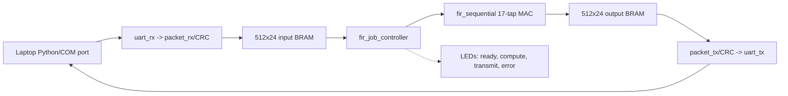

# Board Integration — Arty A7-35T

**Status: design prepared; no bitstream or physical board results yet.**

The original 17-tap FIR core and reference-model tests remain unchanged. The new SystemVerilog modules add a bounded serial sample transport, two 512×24 synchronous-read RAMs, job controller, Xilinx Artix-7 top-level and status LEDs. No camera, audio ADC or second board is required.



Only **motion trajectories** cross USB-UART. At 30 fps and 5 seconds, 150 samples per axis + 16 boundary-pad samples fit a single 512-sample request. X and Y are processed in separate, bit-exact-checked jobs. Python performs pixel warping after FPGA computation.

## HDL hierarchy

```text
arty_a7_maritime_top.sv
├── reset_sync.sv
├── uart_packet_rx.sv
│   └── uart_rx.sv
├── sample_buffer.sv           input RAM
├── fir_job_controller.sv
│   └── fir_sequential.sv     17 taps / ROM / sequential MAC
├── sample_buffer.sv           output RAM
└── uart_packet_tx.sv
    └── uart_tx.sv
```

## Pin constraints

Clock E3, UART_RX A9, UART_TX D10, reset button 0 D9, user LEDs H5/J5/T9/T10. See Digilent [Arty-A7-35-Master.xdc](https://github.com/Digilent/digilent-xdc/blob/master/Arty-A7-35-Master.xdc); official pin mapping must be checked against the actual board revision before programming.

## Build and hardware checks

1. In a Vivado-enabled PowerShell, run `powershell -ExecutionPolicy Bypass -File hardware/sim/scripts/run_maritime_xsim.ps1` to simulate serial request/response and FIR processing (hardware independent).
2. With Vivado GUI **closed**, run `& "C:\AMDDesignTools\2025.2.1\Vivado\bin\vivado.bat" -mode batch -source hardware/vivado/build_maritime_bitstream.tcl` from repo root.
3. Inspect `hardware/build/reports/` for utilization, routing, DRC and timing. **Do not use a bitstream until implementation passes, meets 100 MHz timing, and critical DRC warnings have been audited.**
4. Program board in Vivado Hardware Manager with `hardware/build/maritime_a7.runs/impl_1/arty_a7_maritime_top.bit`.
5. Discover the Arty USB-UART COM port in Windows Device Manager. Observe ready LED0; send a small known impulse request and verify the signed results against Python.
6. Run the short synthetic video through the **physical** board using `python host/stabilize_video.py --port COMx`. Output must say `PHYSICAL FPGA - BIT-EXACT VERIFIED` only after the host confirms exact match.
7. Save actual logs and images in `evidence/hardware/` and record board revision, Vivado version, Git SHA and measured timing/utilization. The camera-motion benchmark target is >=30% high-frequency RMS reduction on both axes.

**Important limitations:** UART is buffered/offline, not continuous camera video. Timing and block RAM mapping cannot be guaranteed until synthesis/route; video demonstration currently uses known synthetic motion, not an arbitrary sea recording. Hardware evidence must be genuine.
