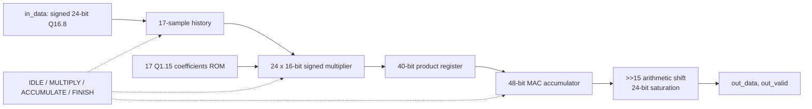

# FIR Core — Implementation and Verification (M1)

**Status (2026-11-17):** Parameter-frozen 17-tap FIR RTL source and self-checking testbench written; Python reference regression **11/11 PASS** in the preparation environment. **SystemVerilog simulator and AMD Vivado were unavailable in that environment; HDL compile/simulation, implementation timing and physical FPGA behaviour remain UNVERIFIED.**

See [master engineering plan](MASTER_PLAN.md) for project-level architecture, release gates and the video/audio application.

## Purpose

The synthesizable SystemVerilog `rtl/fir_sequential.sv` implements a **single**, sequential multiply-accumulate FIR for filtering 1-D signed camera-motion samples (X or Y axis, one job at a time). The host estimates motion trajectories and eventually uses the FIR outputs to re-warp the original images. This file does **not** process image pixels or render video in FPGA logic.

## RTL module and datapath



The internal controller registers one product and then accumulates it in a separate clock. For each input, 17 multiply/accumulate pairs are processed sequentially. A separate finish clock registers the output. **Nominal RTL schedule:** 36 clock periods between successive accepted samples at maximum back-to-back operation (1 acceptance + 34 tap cycles + 1 finish, indexed at acceptance-to-next-acceptance); this is an *architectural* count, not a measured frequency or timing closure result. The RTL computes a new output after the last tap; the pulse is cleared on the following clock unless a new sample is completed. It maintains the history across separate input samples and clears it when reset is asserted.

### Interface

| Signal | Width | Semantics |
|---|---:|---|
| `clk` | 1 | FPGA clock; 100 MHz target, not yet routed |
| `rst` | 1 | Active-high, synchronous; cancels job and clears history |
| `in_data` | 24 signed | Q16.8 trajectory sample |
| `in_valid` | 1 | Input candidate; accepted only when `in_ready=1` |
| `in_ready` | 1 | High only in `IDLE` with reset deasserted |
| `out_data` | 24 signed | Saturated Q16.8 FIR output |
| `out_valid` | 1 | One-clock pulse after completed filtering |

**Pending integration:** UART framing/CRC, job buffering, board top, reset synchronizer and XDC belong to later milestones. No UART or bitstream is included in M1.

## Numerical specification

- Tap count **17**, coefficients **Q1.15**, signed samples **Q16.8**.
- Sampling is **30 camera-motion samples/s** in the model; 100 MHz is the *internal logic* clock.
- Nominal cutoff **2.5 Hz**, Hamming-windowed sinc, symmetric taps.
- Quantisation generated by `host/design_coefficients.py`; **adjust middle coefficient** so integer coefficient sum is exactly **32768** (unity DC gain).
- Multiply 24-bit × 16-bit → signed 40-bit; sign extend into 48-bit accumulator.
- Arithmetic shift right 15. For negative values this is **floor** division by 32768, not truncate-toward-zero.
- Saturate output to signed 24-bit [-8,388,608, +8,388,607]; no wraparound.
- Frozen coefficient text is `rtl/fir_coefficients.txt`. The synthesizable ROM is `rtl/fir_coefficients.svh` generated from that file.

### Frozen coefficients

`[-95, -90, 0, 399, 1282, 2617, 4109, 5291, 5742, 5291, 4109, 2617, 1282, 399, 0, -90, -95]`

Coefficient text SHA-256: `dcd20f90279e4d32f88aface3dfc0be25e94569122e1cba2e365970989cf1e7b`

Preliminary **software-calculated** response at 30 Hz sampling:

| Frequency | Integer-coefficient gain |
|---:|---:|
| DC | 0.00 dB |
| 0.25 Hz | -0.05 dB |
| 1 Hz | -0.78 dB |
| 2.5 Hz | -5.55 dB |
| 5 Hz | -32.12 dB |
| 6 Hz | -64.84 dB |
| 10 Hz | -52.25 dB |
| 15 Hz | -50.31 dB |

These are **software frequency-response calculations, not synthesis, physical FPGA measurements, or proof of video stabilisation**. Note that a 2.5 Hz `firwin`-style cutoff is roughly a half-power transition-region design parameter; it should not be described as a zero-loss passband edge.

## Deterministic regression

`host/generate_vectors.py` creates 8 cases, 1,376 signed motion samples and the corresponding **independently generated Python expected outputs**:

- impulse, positive and negative DC, ramp, zeros;
- signed extremes and seeded pseudorandom values;
- a composite synthetic camera-motion trajectory (`shake`).

The `.mem` files are six hexadecimal digits per 24-bit sample (two's complement) for `$readmemh`. `hardware/sim/vectors/vector_manifest.json` holds deterministic counts and SHA-256 values. The golden model is separately cross-checked against direct-form convolution and edge/saturation handling.

### Required local verification (not performed yet)

**Option A: Icarus Verilog:**

```bash
bash hardware/sim/scripts/run_fir_sim.sh
```

**Option B: Vivado XSim / Windows PowerShell:**

```powershell
powershell -ExecutionPolicy Bypass -File hardware/sim/scripts/run_fir_xsim.ps1
```

The testbench reports `FIR_RTL_REGRESSION_PASS` **only on a successful RTL run**, exercising 8 cases plus a mid-operation reset-cancellation test. Record the command, tool version and actual output transcript; **do not mark M1 passed until the RTL simulation is executed and its results inspected.**

### View M1 source hierarchy in Vivado

```powershell
vivado -mode batch -source hardware/vivado/create_fir_m1_vivado.tcl
```

Open `build/vivado_fir_m1/maritime_fir_m1.xpr` and select **Open Elaborated Design**, **Schematic**, and **Sources → Hierarchy**. This is an **RTL inspection project, not the final board top**; do not generate a board bitstream at this stage.

## Physical-video alignment convention (for later M4)

For offline symmetric filtering (17 taps, 8-sample group delay), pad 8 copies of the first sample before the sequence and 8 copies of the last sample afterward; run the causal core across the padded sequence; take output indices `16..L+15` for original frames `0..L-1`. The function `host/fixed_point_golden.py:centered_smooth()` implements this indexing in software and has independent alignment checks. The final host system **must** apply the same padding/index mapping to values returned from the physical FPGA.

## M1/M2 decision boundary

**Done in this package:** source and testbench authored, coefficients frozen, vector data generated, numerical reference tests passed (11/11).

**Still required:** RTL simulation on a real HDL simulator, Vivado synthesis and timing verification, USB-UART and framing implementation, hardware testing, video demonstration, and eventual publication claims. A successful Python test is not evidence that FPGA hardware is correct.
