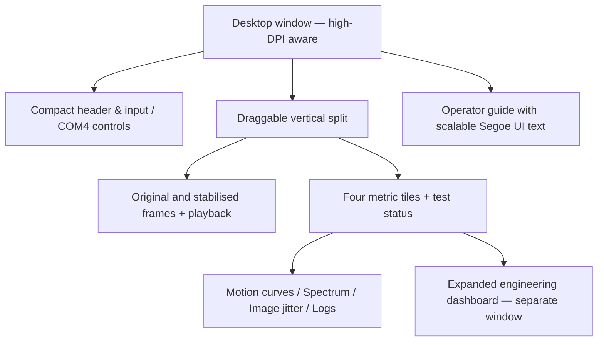
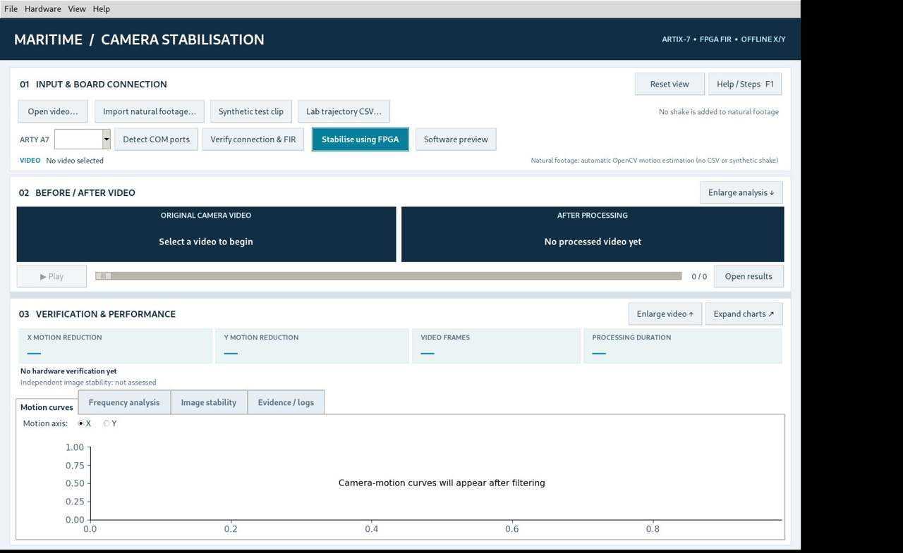
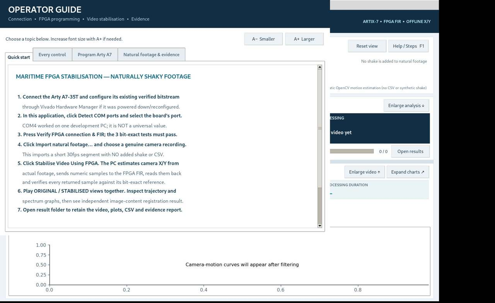
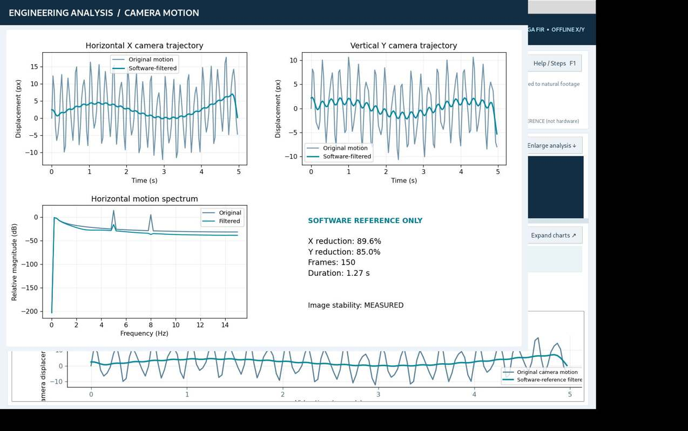

# Maritime FPGA GUI v0.6 — User-interface redesign

**Status:** Desktop and numerical software tested; physical GUI-to-FPGA test on Windows pending.

## Why this version exists

The previous GUI had very small Help text and a cramped plot area on ordinary laptop screens. These were usability issues, not changes to the hardware filter. The underlying verified FIR arithmetic, USB-UART protocol, FPGA RTL, Vivado bitstream, video-motion pipeline and bit-exact hardware gating are retained unchanged.

## Layout architecture



## Improvements

- Main controls use Windows-friendly Segoe UI 11-point type, with more comfortable button padding.
- **Windows process DPI awareness** is requested before the Tk root is created to avoid OS bitmap scaling where supported.
- Resizable video/analysis divider: drag the bar between section 02 and section 03 up/down.
- **Enlarge analysis** and **Enlarge video** buttons make the split easy to adjust without precise dragging.
- **Expand charts** opens a 1320×880 desktop dashboard containing full X-trajectory, Y-trajectory, spectrum and run status. This works with either software or physical FPGA data, with mode identified explicitly.
- The main analysis tabs have more space, higher figure DPI, fixed plot margins and larger legends/axis labels.
- Help: **F1** or **Help / Steps**, four tabs, larger Segoe UI body, formatted steps and subheadings, **A+**/**A−** controls.
- A result produced without FPGA communication is prominently labelled **SOFTWARE PREVIEW — NOT FPGA**.

## Getting started

1. Extract the v0.6 **upgrade ZIP** into the existing working project folder, preserving its `build` directory and existing `.bit`.
2. In the project root, run:

   ```powershell
   python -m pip install -r .\host\requirements.txt
   powershell -ExecutionPolicy Bypass -File .\scripts\run_gui_tests.ps1
   powershell -ExecutionPolicy Bypass -File .\scripts\launch_maritime_gui.ps1
   ```
3. Program Arty A7 with the previously validated bitstream if the board lost configuration. This GUI does **not** program the board.
4. Select the actual UART COM port, run the three-case hardware verification and import recorded maritime footage without synthetic shake.
5. Click **Stabilise using FPGA** and compare the two videos. Use **Expand charts** for a large analytical presentation and export evidence from the result folder.

## Validation and limitations

- **Software regression:** 30/30 existing host tests PASS in the build environment.
- **GUI desktop smoke test:** main window, Help window, expanded dashboard and software-reference video plots successfully opened in a virtual desktop session.
- **Hardware GUI interaction on Windows for v0.6:** NOT YET TESTED. A previously validated v0.5 UART/FIR board path is reused without RTL modifications.
- **Image stabilisation remains X/Y-only** with host-based video decode, OpenCV motion estimation and image warp; the FPGA receives and filters numerical motion samples only.
- A larger or clearer graph is not proof of improved physical camera stabilisation. Report hardware pass, independent video-based jitter measurement, and actual input provenance separately.

## Screenshots






