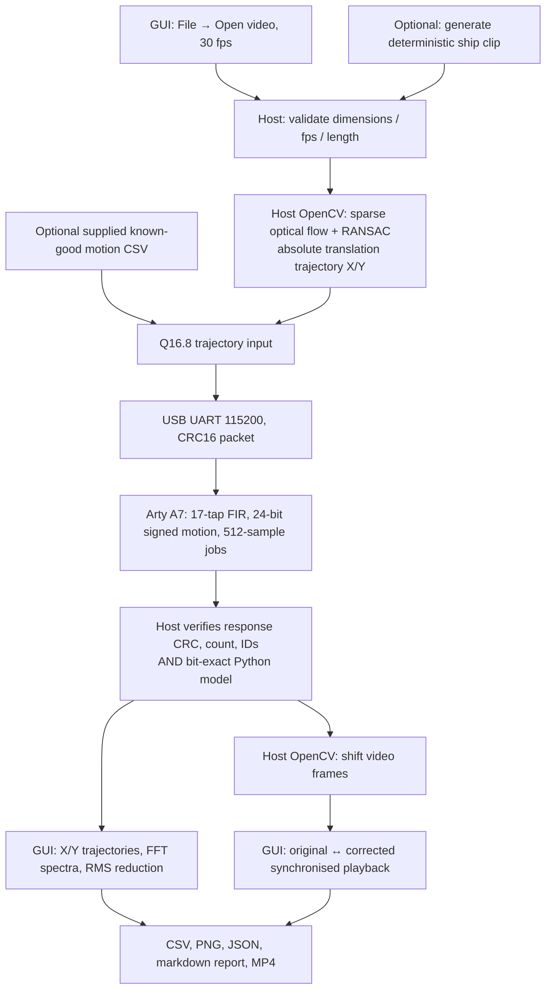

# Interactive maritime camera-motion stabilisation demonstrator

**Version:** local development package v0.3 (17 Nov 2026). **Existing hardware:** Arty A7-35T, 100 MHz SystemVerilog FIR, USB-UART at 115,200 baud. No FPGA changes are required for this GUI extension.

## Purpose

Let an engineer or interviewer load a specified 30 fps video from the **File → Open video** menu, use the **physical FPGA** to smooth measured X/Y motion samples, and inspect original versus stabilised footage **inside one application window**, together with plotted trajectories, spectra and reproducible metrics.

**Crucial scope:** The FPGA filters numerical 1-D motion streams only. The laptop decodes the video, estimates background motion using OpenCV, aligns a symmetric 17-tap FIR, repositions frames and plays back the result. This is a *buffered/offline* hardware-accelerated demonstration, not full-frame image processing on FPGA or realtime marine target-tracking.

## Architecture



## Starting the demonstration on Windows

1. Program the Arty A7 using the bitstream already validated in Hardware Manager. The GUI does **not** program the board.
2. Extract the GUI upgrade into the *existing fully integrated source folder* (the one that already has `rtl`, `host`, `scripts`, `docs`, and `build/vivado_maritime_a7`). Merge directories; do not delete `build` or its bitstream.
3. In PowerShell from the source-root folder, run:

```powershell
python -m pip install -r .\host\requirements.txt
powershell -ExecutionPolicy Bypass -File .\scripts\launch_maritime_gui.ps1
```

4. In the GUI, select **COM4** if that is the Arty UART detected on your machine. Press **Refresh ports** if you reconnected the board.
5. Optionally press **Test FPGA (3 cases)**. It transmits impulse, negative DC and alternating-sign data and requires bit-exact responses.
6. Choose **File → Open video…**. The GUI accepts only eligible, locally decodable video, or press **Generate ship demo** for the deterministic test clip. A suitable `x_q16_8, y_q16_8` CSV may optionally be supplied.
7. Press **Process on PHYSICAL FPGA**. The software computes motion vectors (if no CSV), sends them to the board, verifies results, and builds the side-by-side video.
8. Use **Play/Pause** and the scrub bar to compare the *same frame* in both views. Switch between X/Y motion plots and spectrum, and use **Open result folder** for evidence exports.

**GUI modes are never silently mixed.** “Software preview only” prominently states `SOFTWARE REFERENCE ONLY`; it never pretends to contact the FPGA. The hardware button never substitutes software output when UART or numerical verification fails.

## Supported uploaded video (v0.3)

| Property | Required |
|---|---|
| Container | `.mp4`, `.mov`, `.avi`, `.m4v` if local OpenCV can decode |
| Frame rate | 30 fps (accepted range 29.5–30.5) |
| Width/height | At most 1280 × 720 |
| Length | 18–496 frames, about 0.6–16.5 seconds |
| File size | At most 125 MiB |
| Camera motion | Dominantly 2-D translation with sufficient background features |
| Audio | Ignored in v0.3; audio FIR is a later independent milestone |
| CSV if provided | One row per frame with `x_q16_8` and `y_q16_8` integer columns |

The constraints ensure the 17-tap FIR's eight repeated endpoint pads fit one 512-sample job per axis, avoid resampling a 30 Hz coefficient design unintentionally, and keep video processing practical for this demonstrator.

**Current limitations:** Strong camera roll/pitch perspective, cuts, severe motion blur, low-texture horizons, long recordings, rolling-shutter artifacts or independent ship movement can defeat translation-only stabilisation. The GUI should report estimation errors instead of promising correction. Use recorded/synthetic camera-motion CSV for controlled validation; do not describe a successful synthetic video as proof of performance on arbitrary real footage.

## Reset and physical board interaction

The synthesised top contains an active-high reset input `btn_reset`, mapped in the shipped constraints to **Arty A7 BTN0 (package pin D9)**. Press **BTN0** on the board to restart its UART/FIR state after a stuck packet or communication failure. The FIR controller **automatically clears its input history for each new X and Y filtering job**. A reset is not needed for every video.

**Reset view** only clears GUI results and graphs; it does *not* reset the physical FPGA because the existing UART packet protocol has no remote-reset command. Supporting a true GUI-triggered physical reset would require a specified RTL/protocol change and a new bitstream.

LED indications in the existing top: `LED0` waiting for packet; `LED1` processing FIR; `LED2` serial transmission; `LED3` latched packet error. They are diagnostic indicators, not interactive playback controls.

## Outputs and quantitative evidence

Each run gets a separate timestamped folder under `build/gui_runs/`. It contains:

- `fpga_before_after.mp4` or `software_preview_before_after.mp4` — both streams side by side, with honest mode labels
- `motion_comparison.csv` — original and filtered X/Y trajectory in pixels
- `motion_curves.png` and `motion_spectrum.png` — reusable engineering plots
- `metrics.json` — measured trajectory RMS reductions, source video, mode, hardware COM port, method and elapsed *whole pipeline* time
- `filtered_trajectory.json` — actual result samples (physical hardware when mode states so)
- `estimated_camera_trajectory.csv` — OpenCV-derived motion, when a user video has no supplied CSV
- `RUN_REPORT.md` — summary, evidence paths and limitations

**Shake metric:** Percentage decrease in RMS high-frequency trajectory residual after subtracting a 31-frame centred moving average. This is a useful quantitative benchmark, not an image-quality score, ship-target-lock measurement, or the FPGA's arithmetic latency.

## Testing and release gate

- [x] Python reference/serial protocol tests passed in the previous integration.
- [x] User reported physical Arty A7 COM4 UART/FIR 3-case bit-exact smoke PASS and hardware-backed synthetic video X/Y pass (17 Nov 2026).
- [x] Host OpenCV video-import/trajectory estimate and output pipeline validated on synthetic footage by 23 software tests, plus headless GUI smoke on this development package.
- [ ] **User to validate GUI behaviour with programmed Arty A7 on Windows (COM4)** — especially menu upload, hardware playback, graphs and exports.
- [ ] Real externally recorded, non-synthetic maritime clip validated under supported limitations.
- [ ] Final GitHub portfolio upload with hardware UI evidence and limitations after local GUI acceptance.

This v0.3 source package is an integration candidate; it does not replace the existing passed board bitstream or make new physical hardware claims by itself.
