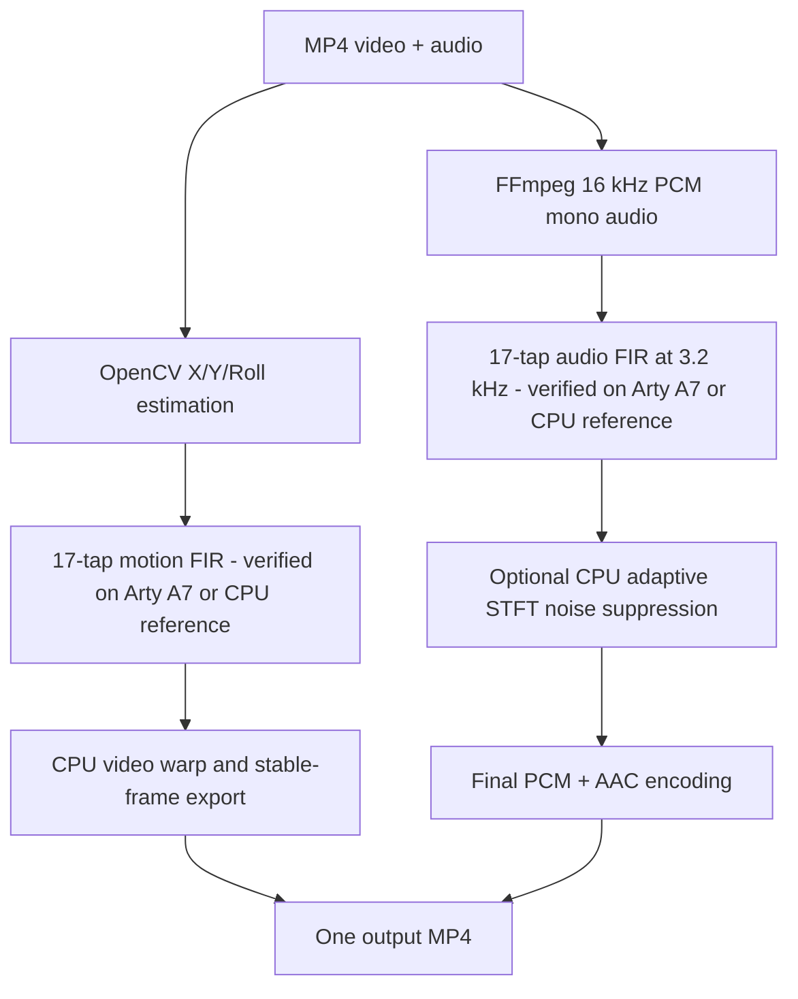

# Unified Maritime Video + Audio DSP — Adaptive audio development v1.1

## Objective

Process **one source MP4** into one video with stabilised frames and reduced unwanted audio while retaining independent, honest evidence about which stages ran on the **physical Artix-7** and which ran on the laptop. The GUI has four primary tabs: **Implementation**, **Video Assessment**, **Audio Assessment**, **Help**.

## Architecture and hardware boundary



**The adaptive spectral denoiser does NOT run on the FPGA.** The Arty A7 remains responsible for numeric motion and audio FIR processing; FPGA results are compared bit-for-bit against Python. In software preview both FIR engines also run on the laptop. Frame warping, adaptive spectral enhancement, WAV/AAC encoding and the GUI always run on the laptop. Neither source video nor raw audio is streamed directly into the FPGA fabric.

## Audio algorithms

1. **FIR low-pass, unchanged:** 17 taps, nominal 3.2 kHz cutoff at 16 kHz, selected via the UART audio job bit. Mainly removes out-of-band hiss. The existing bitstream can be reused. Samples and fixed-point arithmetic remain unchanged.
2. **Optional host spectral enhancement (new):** 512-point Hann-window STFT, 128-sample hop; estimate a noise spectrum from the lowest-energy 20% of frames; apply soft Wiener-style attenuation with frequency/time smoothing and a protective gain floor; suppress 70–160 Hz marine rumble with a gradual high-pass transition; reconstruct via weighted overlap-add to the original sample count. Very stationary audio without low-energy intervals is handled conservatively to avoid mistakenly suppressing a continuous voiced tone.
3. **Choose mode:** File → **Audio cleanup mode** → `Maritime adaptive` (default) or `FIR only` (reference). One MP4 with the selected filtered soundtrack is produced in either case.

This estimator assumes the video contains enough quieter intervals to estimate background noise. It can underperform on continuous speech, gusts, waves, nonstationary machinery noise and distorted microphones. Background sound and voices overlap in frequency; complete elimination or improved intelligibility is not guaranteed. The chosen source includes AI-generated media; do not present it as a real recorded-vessel field test.

## GUI structure

**Implementation** retains the compact control row and two large synchronised video panels. Source files are kept under `videos/`. Software and physical result directories remain separate as `videos/sim/` and `videos/hrd/`.

**Video Assessment** shows filename, hardware/software motion FIR status, X/Y/Roll trajectory and image-stability charts, cropping warnings and evidence log.

**Audio Assessment** shows filename, audio FIR status, exact final audio stage attribution, full-size original/FIR-only/final audio spectrum, and three band-energy comparisons: 40–180 Hz rumble, 250–3000 Hz speech band and 5–7.5 kHz high band. Spectral attenuation is **not** a direct SNR or speech-intelligibility score.

**Help** explains both stages, bitstream programming and the difference between physically verified FIR output and CPU postprocessing.

Saved for every unified job: `audio_original.wav`, `audio_fir_only.wav`, `audio_filtered.wav`, `audio_AB_compare.wav`, `combined_metrics.json`, `metrics.json`, `final_stabilised_filtered_audio.mp4`. Compare WAV files to hear whether the result is actually better; preserve negative results.

## Validation gates

- Numerical FIR bit-exact tests are unchanged, including job-bank switching and UART packet overlap; physical proof from previous short v1.0.3 runs is not a new v1.1 hardware test.
- Synthetic audio tests verify equal sample length, finite output, quiet/noise estimation, rumble suppression, and preservation of steady voiced tones under conservative settings.
- GUI tests verify that audio and video assessments are separate, with full-height plots.
- End-to-end software 3-second test exports an MP4 with a real AAC track and all three audio WAV stages.
- **Pending on user's Windows workstation:** listening quality, audio-video sync, new hybrid mode on COM4, full 30-second hardware run, adverse sea/wind examples. No claim of total noise removal or speech-intelligibility enhancement before perceptual assessment.

## Run

```powershell
python -m pip install -r .\host\requirements.txt
powershell -ExecutionPolicy Bypass -File .\scripts\run_gui_tests.ps1
powershell -ExecutionPolicy Bypass -File .\scripts\launch_maritime_gui.ps1
```

Choose **Video + Audio**, select the supplied three-second video, try **Software preview**, inspect both assessment tabs and listen using **Original / Filtered**. Then select **FIR only** in the File menu, repeat, and compare. For physical work, program the existing validated **dual-bank** bitstream first, select COM4, **Verify FPGA** and **Process on FPGA**. The physical device verifies FIR; the optional adaptive suppression continues on the PC.
