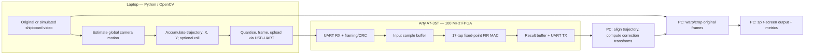
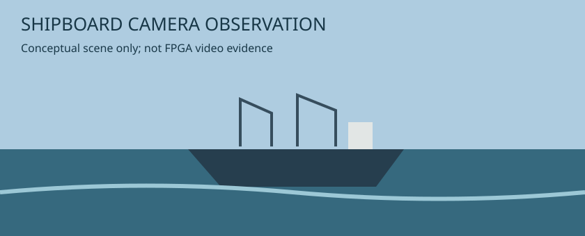
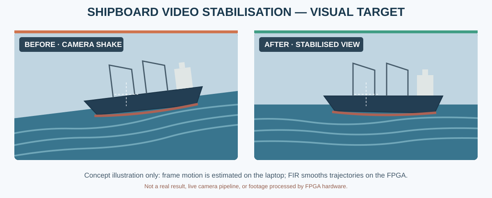
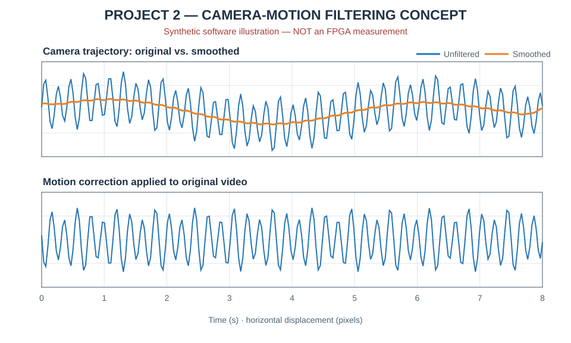
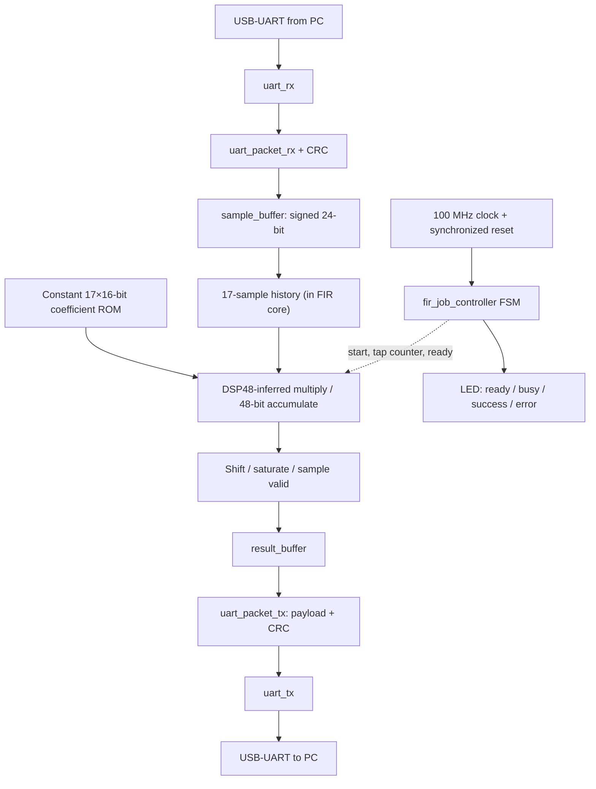
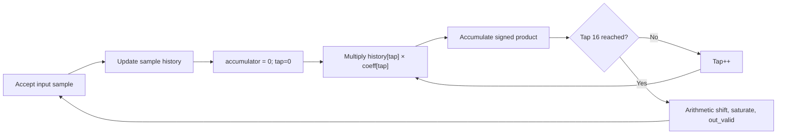
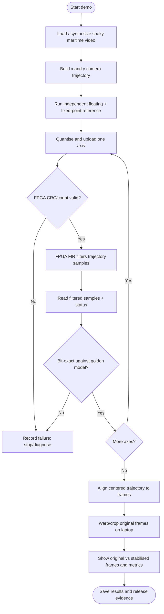
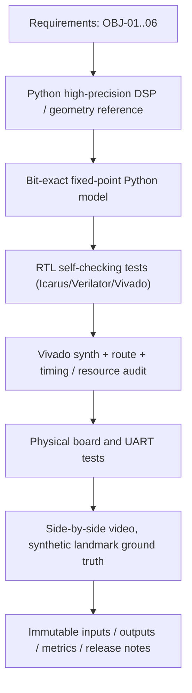
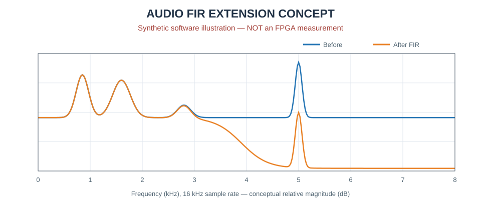
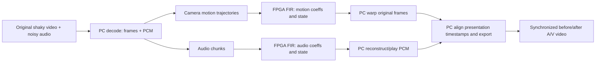

# FPGA Maritime Video Stabilisation & Audio Noise Reduction

> **Master engineering plan and progress tracker — v1.0 planning baseline**  
> **Established:** 17 November 2026  
> **Status:** PLANNED — no RTL implementation, Vivado result, physical FPGA validation or video stabilisation performance is claimed here.  
> **Primary hardware:** one existing Digilent Arty A7-35T (`xc7a35ticsg324-1L`), laptop and USB cable.  
> **Development environment:** AMD Vivado 2025.2.1 (target version), SystemVerilog, Python, OpenCV, NumPy/Matplotlib.  
> **Release policy:** complete a narrowly scoped **v1.0 video-motion demo first** (target: 1–2 focused working days); audio and integration are separately gated extensions.  
> **Repository:** [`msamie-elec/FPGA-maritime-motion-audio-dsp`](https://github.com/msamie-elec/FPGA-maritime-motion-audio-dsp) — version-controlled design and evidence.

## 0. Read this first: project charter and honest scope

**Aim:** Build a small, reproducible **FPGA hardware-accelerated motion-trajectory smoothing demonstrator** for an illustrative shipboard camera view, later extending the same FIR intellectual-property (IP) core to frequency-selective audio noise reduction. Produce a split-screen, genuinely hardware-processed demonstration, rigorous simulation and implementation evidence, and GitHub/LinkedIn/Upwork case studies.

**What the FPGA does:** A configurable, signed fixed-point **FIR filter** and controlled sample buffering/serial transfer. **What the laptop does:** Video decoding or synthetic video creation; estimating *global background/camera motion*; constructing motion trajectories; correcting image geometry and cropping; audio file handling; plotting and displaying output. The FPGA does **not** receive or transform full video frames in v1.0 and does **not** process RF/video camera interfaces. The demonstration is *offline/buffered*, not a real-time video-rate FPGA vision appliance.

**Problem statement:** A ship-mounted camera can suffer pitch, roll and vibration. A recorded view may shake despite the observed scene being relatively stable. After estimating unwanted camera motion, we want to smooth the camera-motion trajectory with deterministic fixed-point FPGA hardware and warp the *original* frames accordingly. The other observed ship may still move independently: **this is view stabilisation, not target lock or tracking**.

**Standalone engineering deliverable:** All RTL components, filter coefficients, UART protocol definitions, simulation tests, Vivado build scripts, Python analysis code and reproduction instructions must be present in this repository. No preceding project is required to understand, build or verify the system.

### Project boundaries

| In v1.0 (MUST) | Later version (NOT v1.0 release blocker) |
|---|---|
| One physical Arty A7-35T, SystemVerilog FIR | Second Arty or multi-board operation |
| Deterministic synthetic shaky ship-view video | Robust arbitrary real maritime video |
| Python motion trajectories → USB-UART → FPGA → Python | Direct FPGA video input, camera interfaces, DDR frame buffer |
| FPGA 17-tap fixed-coefficient low-pass motion FIR | Runtime coefficient reload, 32/64-tap/symmetric alternative architectures |
| x/y motion correction; roll rotation optional stretch | Multi-target tracking / robust 3D stabilisation |
| Side-by-side original/stabilised video and motion plots | Audio FIR and combined audio-video presentation |
| Bit-exact verification, timing/resource report | HLS, AI-based motion estimation, high-throughput imaging |

**Why 17 taps rather than the earlier generic 32-tap suggestion?** This is a deliberate, documented v1.0 simplification for video: a symmetric **odd** tap count has an **integer eight-frame group delay**, allowing straightforward centred offline alignment. The FIR RTL is parameterised; a 32/33/65-tap comparison remains available later. A 17-tap filter also avoids excessive temporal smoothing in short 30 fps clips. This is not an assertion of optimal stabilisation quality; it must be checked in the experiments.

---

## 1. Objectives, measurements and deliverables

| ID | Objective | Evidence required | Status |
|---|---|---|---|
| OBJ-01 | Extract or generate known camera-motion trajectories | Deterministic synthetic reference and trajectory CSV | ⬜ Planned |
| OBJ-02 | Implement a synthesizable fixed-point FIR in the Arty A7 | Modular RTL, waveforms, implemented bitstream | ⬜ Planned |
| OBJ-03 | Transfer trajectories to and from the *physical* FPGA | UART transaction log, sample count, integrity check | ⬜ Planned |
| OBJ-04 | Stabilise visual content using FPGA-filtered trajectory | Side-by-side before/after clip, original video kept | ⬜ Planned |
| OBJ-05 | Demonstrate correct and measurable FPGA behaviour | Python bit-exact comparisons, DSP utilisation and timing | ⬜ Planned |
| OBJ-06 | Make the result reproducible and portfolio-ready | GitHub README, Tcl build, logs, screenshots, limitations | ⬜ Planned |
| OBJ-07 | Extend same FIR IP to audio (v1.1) | Actual FPGA-filtered audio, before/after listening + spectrum | ⬜ Planned |
| OBJ-08 | Combine video and audio processing (v1.2) | Synchronized exported side-by-side A/V demonstration | ⬜ Planned |

**Deliverables at v1.0 completion:** (1) SystemVerilog modules and self-checking testbenches; (2) reproducible Vivado Tcl build and constraints; (3) Python reference and UART app; (4) synthetic, reproducible demonstration clip; (5) side-by-side output video and plots; (6) honest timing/resource/precision results; (7) README and release notes. **No unmeasured performance claim.**

## 2. System context and application architecture



**Interpretation:** Video frames never traverse the UART. For v1.0 the FPGA receives only **sampled motion coordinates** (much smaller than pixel arrays). This limitation makes the one-board design realistic and keeps the total job manageable.



*Figure 1. Illustrative shipboard camera observing a distant vessel across rough seas. This is an application scene, not a captured experiment.*



*Figure 2. The desired side-by-side presentation. It illustrates camera-motion correction; the actual before/after demo must be generated from the same video footage and hardware-returned motion samples.*



*Figure 3. Synthetic motion trajectories demonstrate the desired effect. Replace this illustration with measured FPGA traces in the verified release.*

## 3. Video-processing theory and algorithm

### 3.1 Camera-motion estimation (on laptop)

1. Load a small 5–8-second 640×360 or 720p, 25/30 fps clip. For the **release gate**, generate a deterministic synthetic image/scene with a distant ship/horizon, apply known shake (x/y and optionally roll), and store the ground-truth transforms.
2. For a real clip *optional*, detect stable background features, estimate inter-frame transforms using OpenCV optical flow (e.g. `goodFeaturesToTrack` / `calcOpticalFlowPyrLK`) and robust `estimateAffinePartial2D` with RANSAC. Exclude the independently moving target ship when possible.
3. Accumulate global frame transforms into a trajectory. In simple small-angle cases, represent as per-frame position `(x[n], y[n])` and unwrapped rotation `theta[n]`; for general transforms use 3×3 homogeneous matrix composition rather than merely adding affine matrix entries.
4. Select the intended camera path: preserve slow intentional pan/tilt while reducing higher-frequency shake. A filter cannot infer intentional motion perfectly from frequency alone.
5. Encode each trajectory **one axis at a time** for the FPGA FIR. This avoids three parallel filters or complicated multi-channel RTL in v1.0. For v1.0, X and Y are required; rotation is a separately gated enhancement.

### 3.2 FIR mathematical model

For a causal N-tap FIR:

$$
y[n]=\sum_{k=0}^{N-1}h[k]x[n-k]
$$

Use **N = 17** and symmetric coefficients (`h[k] = h[16-k]`) calculated by a windowed-sinc / Hamming method, normalized for DC gain ≈ 1. Choose the *actual* cutoff after testing a frozen 30 fps motion trace (for example an initial 2–3 Hz candidate); do **not** claim a specified shake-rejection number until verified.

**Finite-precision formats for v1.0:** sample coordinate signed **24-bit Q16.8** (1/256 pixel or degree resolution, depending on channel); FIR coefficient signed **16-bit Q1.15**; full multiply **40 bits**; signed accumulator **48 bits** with guard margin; arithmetic right shift **15** and signed output saturation to 24 bits. Use a specified truncation rule (arithmetic shift toward negative infinity) in *both* hardware and bit-exact Python model. 24×16 arithmetic fits a DSP48E1 multiplier's 25×18 operand widths, subject to Vivado mapping.

**Coefficient quantisation:** Freeze one coefficient file and checksum it. Quantize to Q1.15 and adjust the centre tap so the integer coefficient sum is **32768**, where representable, guaranteeing unity DC gain in exact arithmetic. Audit coefficient symmetry and accumulator range.

**Time alignment:** With symmetric N=17, linear-phase delay is `(N-1)/2 = 8` motion samples, i.e. ~267 ms at 30 fps. This is **not the FPGA clock-cycle computation latency**. Because the application is offline, the laptop can pad the trajectory with 8 repeated first values and 8 repeated last values, run the causal FIR, and align output sample `y[k]` at `k = 16 ... N_frames+15` with original trajectory frame `k-16`. The software reference must prove indexing on an impulse/ramp test. An online version would need future frames or accept output delay.

**Video warp:** If `T_original[n]` maps a stable scene/reference to original frame n and `T_smoothed[n]` is the desired smoothed transform in the same convention, the correction is conceptually `C[n] = T_smoothed[n] * inverse(T_original[n])`. Confirm the actual OpenCV `warpAffine` mapping and flags against known synthetic landmark locations; incorrect transform direction will *increase* shake. Crop/zoom constraints and boundary fill must be documented.

**Do not run an FIR on image RGB intensity to stabilise motion.** This would smooth/blur pixels, not compensate geometric camera shake.

### 3.3 Visual result and measurement

Show two synchronized panels from *the same input frames*, **Before** and **After**, with optional overlays displaying the original and FPGA-smoothed trajectory. Measure on the deterministic synthetic data: input-vs-output high-frequency trajectory RMS, landmark/background displacement RMS after warping, cropping/black borders, and exactly matched frame counts. A moving target ship need not be stationary after background stabilisation.

## 4. Complete RTL hierarchy for Vivado

```text
arty_a7_maritime_top.sv                   TOP: clock, reset, UART, buttons, LED
├── reset_sync.sv                         synchronous reset release
├── uart_rx.sv                            local UART receiver (provenance recorded)
├── uart_packet_rx.sv                     request decode, count, CRC/status
├── fir_job_controller.sv                 IDLE/LOAD/RUN/READ/ERROR FSM
│   ├── sample_buffer.sv                  FPGA input BRAM/distributed RAM
│   ├── sample_tick_gen.sv                optional sample scheduling
│   ├── fir_sequential.sv                 ONE reusable fixed-point FIR core
│   │   ├── sample_history[0:16]          registers, inside entity
│   │   ├── fir_coefficients[0:16]        fixed ROM constants, inside entity
│   │   ├── tap-index / MAC datapath      sequential mult-accumulate
│   │   ├── 48-bit accumulator            fixed-point guard precision
│   │   └── scale, saturate, out_valid    completion handshake
│   └── result_buffer.sv                  buffered return samples
├── uart_packet_tx.sv                     response packet + CRC
└── uart_tx.sv                            reused/adapted with documented licensing
```

Only **the named `.sv` files** are independent modules. The five items indented inside `fir_sequential.sv` are internal datapath/register elements (not separate Vivado entities) for minimal v1.0 complexity. `sample_tick_gen.sv` is optional in batch mode; for batch jobs the FIR job controller can initiate the next sample when `ready=1` and measure processing cycles. For the 30 fps application, host motion samples arrive in batches; the FPGA does **not** operate as a native 30 fps video interface.

### Functional FPGA block diagram



### FIR sequential MAC timing concept



**Clocking, reset and timing:** One 100 MHz clock domain; externally asynchronous UART RX must be synchronized; reset deassertion synchronized; a deterministic sample-valid/ready handshake prevents overwrite. Constraint file must define input clock, correct verified A7 UART and LED pins; audit unconstrained inputs, setup/hold and CDC/methodology warnings. No PLL, DDR, DMA, Ethernet or multi-clock FIFO is necessary.

### UART protocol (proposed, freeze before RTL)

- 115,200 baud, 8N1, same host USB connection used by Vivado JTAG; discover COM port rather than hardcoding COM4.
- Minimal framed *binary* request: 2-byte `0xA5 0x5A` sync, 1-byte version, 1-byte command, 1-byte job_id, 2-byte sample count (little-endian), signed 24-bit little-endian payload (one trajectory axis), and CRC-16/CCITT-FALSE for header+payload (document precise covered bytes in implementation).
- Response: sync/version/command/job_id, status code, sample count, signed 24-bit results, CRC-16; reject unsupported lengths, bad CRC or unrecognised commands with explicit error status and no stale data.
- Single outstanding job; a 512-sample maximum including padding is enough for a ~8-second/30 fps clip; **three sequential jobs** can process x, y and (later) roll, avoiding three separate FIR engines.
- Freeze the wire byte order and CRC test vectors in `docs/PROTOCOL.md` when implementation begins. Include reset/retry, stale responses, timeout handling and exact input/output count checks in host tests.

**Why batch mode?** It keeps v1.0 demonstrable via USB-UART at modest bandwidth. Host transfer time is separate from measured FPGA FIR computation time. Audio in v1.1 will require chunking and preserved history or independently padded blocks.

## 5. Operating flowchart and test workflow



### Practical GUI/demo modes

1. **No-board quick preview:** Software-only reference on deterministic synthetic video; label prominently *SOFTWARE REFERENCE ONLY*.
2. **Physical-FPGA mode (release target):** Python uploads the same motion vectors, verifies FPGA-produced values, warps frames, exports before/after MP4 with measurements and prints the connected FPGA version/identity where available.
3. **Optional real video mode:** Use own/licensed short footage, background motion estimation and compare against synthetic ground truth; clearly distinguish from synthetic test.

## 6. Implementation methodology and one-to-two-day schedule

**Day 1 — Design, reference and simulation**

- [x] M0.1 Record the engineering charter, first release boundaries and initial documentation under version control (17 November 2026); no hardware results are claimed.
- [ ] M0.2 Verify target board identity `xc7a35ticsg324-1L` and Vivado version/tool paths.
- [ ] M0.3 Generate synthetic moving maritime video, known x/y trajectories and fixed-point test vectors.
- [ ] M0.4 Design 17-tap symmetric low-pass coefficients in Python, quantise Q1.15, freeze coefficient file and its checksum.
- [ ] M0.5 Implement `fir_sequential.sv`, its sample history, fixed-point math, `in_valid/in_ready/out_valid` and reset semantics.
- [ ] M0.6 Simulate impulse, constant, ramps, random signed values, overflow/saturation and back-to-back samples against bit-exact Python model.
- [ ] M0.7 Run a preliminary Vivado synthesis and inspect inferred multiplier/DSP48, register and memory resources.

**Day 2 — Physical FPGA and publication gate**

- [ ] M1.1 Implement UART packet RX/TX, CRC, buffers, controller, LED status and A7 top-level; provide and test all local UART RTL with licensing/provenance recorded.
- [ ] M1.2 Implement `create_project.tcl`, `build.tcl`, correct A7 XDC; synthesize, place-and-route, generate bitstream and audit setup/hold/unconstrained paths.
- [ ] M1.3 Program physical Arty A7; prove single known vector, then 256-sample job, then repeated/negative/large-value jobs.
- [ ] M1.4 Send x/y trajectory jobs from Python; verify exact counts/CRC, reject invalid frames and compare FPGA outputs to the frozen fixed-point model.
- [ ] M1.5 Produce original/stabilised split-screen video from **hardware-returned** trajectories and save raw measurements.
- [ ] M1.6 Save Vivado reports, software versions, source SHA or tag, photo/screenshots, known limitations, and concise GitHub README / portfolio notes.
- [ ] M1.7 Apply release gate in §8, tag `v1.0` if—and only if—mandatory checks pass.

**Hard stop:** After the v1.0 gate, release the physically demonstrated x/y stabilisation case study. Do not hold it hostage to rotation, arbitrary real-footage robustness, audio, a second board or a GUI framework. If a required test fails, report it accurately and do not label a release 'hardware-verified'. The 1–2 days are a **planning target**, not a guarantee.

## 7. Verification plan: four independent layers



| Gate | Test | Pass criterion | Evidence file (to produce) |
|---|---|---|---|
| T-01 | Impulse, DC, ramp, symmetry, signed extremes | Reproducible reference results and correct coefficient sum | `results/sim/fir_vectors.csv` |
| T-02 | Pseudorandom 24-bit input, overflow/rounding | **Bit-exact** signed 24-bit result and correct sample order for all evaluated outputs | `results/sim/fir_random.json` |
| T-03 | Reset mid-job, invalid CRC, overlength job, missing bytes, wrong job_id | Controlled rejection/recovery; no stale accepted data | `results/sim/protocol.json` |
| T-04 | Vivado A7-35T synth/route | No build failure; constrained setup/hold WNS/WHS ≥ 0; no unexplained critical CDC/timing issues | `results/vivado/summary.md` |
| T-05 | Physical UART and FPGA MAC | Known and 256-sample hardware vectors match bit-exact model, count exact, CRC valid | `results/hardware/capture.csv` |
| T-06 | Deterministic synthetic ship clip | Reduced unwanted background motion with **target ≥30% reduction** in high-frequency trajectory RMS; no lost/duplicated frames; crop recorded | `results/video/metrics.json` |
| T-07 | End-to-end provenance | Version, tool versions, board, SHA, input seed, signal coefficients recorded; separate software vs FPGA claims | `docs/VALIDATION.md` |

**30% reduction is a design aspiration, not a measured or universally guaranteed result**; evaluate on frozen synthetic shake data, preserving intentional low-frequency pan. A real-footage test can be useful even when no ground truth exists, but it does not replace T-05 or synthetic proof. Report black borders/crop and any wobble artefacts. Never claim full motion tracking, real-time 30 fps camera throughput, or direct FPGA image processing.

**Special test for alignment/sign:** Place synthetic landmarks at known image coordinates, impose known ±x, ±y and roll motion, and verify that computed OpenCV warps move them in the expected compensating direction. Test the first and last 8 frames explicitly.

## 8. Definition of done and release decision

**v1.0 is accepted ONLY when all of the following are checked:**

- [ ] One real Arty A7-35T programmed with the exact audited bitstream.
- [ ] Independent Python golden model and self-checking RTL regression PASS.
- [ ] Physical FPGA returns correctly counted, CRC-valid, **bit-exact** motion-filter outputs.
- [ ] On actual hardware-returned x/y outputs, a split-screen video is generated and the frozen synthetic benchmark **meets the ≥30% high-frequency shake-reduction target**; observed artefacts/crop are reported.
- [ ] Vivado full implementation resource/timing report exists; limits and warnings are honestly disclosed.
- [ ] Repository includes documented reproduction steps and non-proprietary/appropriately licensed demonstration assets.
- [ ] `README.md` clearly explains that Python processes pixels and the FPGA processes motion trajectories.

| Release | Scope | Status | Evidence gate | Decision |
|---|---|---|---|---|
| `v1.0` | x/y video-motion smoothing | **PLANNED** | T-01 to T-07 | NOT RELEASED |
| `v1.1` | audio noise-reduction FIR | **BACKLOG** | audio golden model + true FPGA audio output | NOT STARTED |
| `v1.2` | integrated before/after A/V demo | **BACKLOG** | synced video/audio and quality measurements | NOT STARTED |
| `v2.x` | advanced FIR architectures / higher-performance vision | **IDEAS ONLY** | separate specification | NOT SCHEDULED |

## 9. Audio extension (v1.1 — only after v1.0)



**Aim:** Send PCM audio from laptop to FPGA and return filtered samples. Start with deliberately inserted **out-of-band** noise (e.g. a 5 kHz tone in a 16 kSamples/s speech-like signal) to demonstrate frequency-selective noise rejection. A conventional static FIR **cannot reliably eliminate arbitrary speech-band noise, wind, or another voice that overlaps the desired speech spectrum**.

- Use signed 16-bit mono PCM at **16 kHz** for the first audio experiment.
- Reuse the same 24-bit FIR input path by sign-extending 16-bit PCM samples; coefficients remain signed Q1.15, with a distinct **audio coefficient bank** (e.g. 33/65 taps subject to validation).
- Use buffered transfer, 256/512-sample chunks and **preserved FIR sample history** across contiguous blocks, or process a padded whole short segment if buffered resources allow. Avoid seam artefacts.
- On laptop: play original and FPGA-returned audio; plot spectrogram, target frequency rejection, desired-band distortion and bit-exact output comparison.
- Do not claim true real-time audio streaming over a 115200 baud, 8N1, 16-bit bidirectional UART. Approximately **320 kbit/s per direction** would be required for 16 kHz × 16 bits even before serial framing, far exceeding the chosen baud. Offline chunks are intentional.
- Keep video and audio coefficients, sample rates and FIR state **independent** even if the arithmetic datapath is shared or time-multiplexed.

## 10. A/V integration (v1.2 — future)



The boxes 'FPGA FIR' are logical channels: one time-multiplexed arithmetic core may service both in sequence with separate state/coefficients. A second physical FPGA is **not** required. For actual simultaneous operation, design bandwidth and buffering afresh rather than inferring it from offline evidence.

## 11. Repository / Vivado development structure

```text
FPGA-maritime-motion-audio-dsp/
├── README.md
├── .gitignore
├── LICENSE                         # select a licence before a future public release
├── docs/
│   ├── MASTER_PLAN.md    # THIS master reference, progress gates
│   ├── ARCHITECTURE.md             # source-level detail added during RTL implementation
│   ├── PROTOCOL.md                 # frozen UART protocol and examples (future)
│   ├── VALIDATION.md               # measured evidence, only after actual runs
│   └── figures/
│       ├── motion_trajectory_concept.svg
│       └── audio_spectrum_concept.svg
├── rtl/
│   ├── arty_a7_maritime_top.sv
│   ├── reset_sync.sv
│   ├── uart_rx.sv                   # standalone and tested; record provenance
│   ├── uart_tx.sv                   # standalone and tested; record provenance
│   ├── uart_packet_rx.sv
│   ├── uart_packet_tx.sv
│   ├── fir_job_controller.sv
│   ├── sample_buffer.sv
│   ├── result_buffer.sv
│   ├── fir_sequential.sv
│   └── fir_coefficients.svh
├── tb/
│   ├── tb_fir_sequential.sv
│   └── tb_arty_a7_maritime_top.sv
├── host/
│   ├── generate_synthetic_clip.py
│   ├── extract_motion.py
│   ├── design_coefficients.py
│   ├── fixed_point_golden.py
│   ├── fpga_serial_client.py
│   ├── stabilize_video.py
│   └── run_demo.py
├── constraints/
│   └── arty_a7_35.xdc
├── scripts/
│   ├── create_project.tcl
│   ├── build_vivado.tcl
│   ├── run_sim.ps1
│   └── audit_vivado.py
├── tests/
│   └── test_fixed_point.py
├── evidence/                      # selected public, anonymised, small results
└── build/                         # ignored local generated files; never commit
```

**Implementation guidance:** Keep module file names and entity instances stable; use `create_project`, `add_files`, `set_property top`, synthesis, implementation, timing and utilisation reports. Open generated `.xpr` in Vivado to inspect **Sources → Hierarchy**, elaborated schematic, simulated waveforms, DSP48 inference, XDC and routed timing. Do not commit generated Vivado project caches, IP metadata unrelated to this build, system-specific paths, device IDs or confidential source footage. Incorporate GitHub Actions Python/RTL regression once tests are implemented and passing; do not publish a deceptively green placeholder CI.

## 12. Risk register and mitigations

| ID | Risk | Mitigation / decision |
|---|---|---|
| R-01 | Real clip's moving ship confuses motion estimator | Synthetic ground truth mandatory; select background features / region masking for real clip |
| R-02 | Filter suppresses intentional pan or lags footage | Filter **global trajectory**, use centered offline alignment and cutoff checks; measure smoothing/crop |
| R-03 | 17 taps not enough or too strong for a particular clip | Record quality; trial 9/17/33 taps **after** basic v1.0, without holding release indefinitely |
| R-04 | UART transfer protocol causes stalls / data corruption | CRC and bounded count, tested UART reused, timeouts, one outstanding transaction |
| R-05 | Sign, rounding, overflow, endianness differ | Exact reference model, signed edge cases, impulse/step/random regressions |
| R-06 | Synthesis does not infer DSP48/BRAM as expected | Inspect Vivado post-synth resources and adjust only based on reports |
| R-07 | Camera roll needs projective or geometric handling | First release x/y only; angle correction optional; avoid claims of complete rough-sea compensation |
| R-08 | Audio noise overlaps speech frequencies | Clearly separate band-limited FIR filtering from adaptive speech enhancement |
| R-09 | User footage cannot be redistributed | Use original synthetic or properly licensed footage, save attribution/licence |
| R-10 | Scope expands and v1.0 is never published | Hard release gate; optional versions separately tracked and not mandatory |

## 13. Progress checklist, decision log and review cadence

### Compact status board — update as we go

| Milestone | Description | Status | Evidence / date |
|---|---|---|---|
| M0 | Documented baseline + environment + frozen requirements | 🟨 In progress | Planning baseline committed, 2026-11-17; environment/requirements gate pending |
| M1 | Golden coefficients + core FIR RTL simulation | ⬜ Not started | — |
| M2 | Vivado synthesis/implementation | ⬜ Not started | — |
| M3 | Physical FPGA serial loop + exact DSP vectors | ⬜ Not started | — |
| M4 | Before/after stabilised ship video + metrics | ⬜ Not started | — |
| M5 | GitHub v1.0 portfolio release | ⬜ Not started | — |
| M6 | Audio FIR v1.1 | ⬜ Backlog | — |
| M7 | Combined A/V v1.2 | ⬜ Backlog | — |

**Update policy:** At the end of each milestone, replace status with PASS / BLOCKED / PARTIAL, record date, tested source commit/hash and exact evidence path, and write 2–3 lines on results. Do not mark a gate complete on simulation evidence if it requires physical hardware.

### Decision log

| Date | Decision | Rationale |
|---|---|---|
| 2026-11-17 | Present this project as a **standalone DSP engineering demonstrator** | All requirements, design and verification evidence must be understandable within this repository |
| 2026-11-17 | First release is camera-motion FIR only | Shortest credible hardware-to-visual case study |
| 2026-11-17 | Use A7-35T and SystemVerilog | Available hardware and toolchain; maintain a reproducible RTL/build workflow |
| 2026-11-17 | v1.0 uses **17-tap symmetric motion FIR** (not 32-tap audio-style baseline) | Integer 8-frame alignment and short video-motion smoothing window |
| 2026-11-17 | FPGA filters *motion trajectories*, not pixels | Accurate and feasible description of v1.0 |
| 2026-11-17 | Audio and integration are future separate release gates | Prevent indefinite scope expansion |

**Review after each milestone:** (1) Which objective IDs advanced? (2) Which pass/fail evidence exists? (3) Did the hardware actually perform the claimed operation? (4) Are new requirements outside v1.0? (5) Does the public README exactly match verified results? If not, correct plan/status before starting the next milestone.

## 14. Portfolio positioning / industrial applications

**Industrial application contexts:** maritime electro-optical observation, shipboard platform-motion compensation, airborne/robotic camera stabilisation, sensor-data smoothing, and basic embedded audio DSP. This demonstrator does not establish a qualified defence/marine imaging product, all-condition target tracking, real-time full-frame FPGA acceleration or general-purpose noise suppression.

**Working title for v1.0:** *FPGA Camera-Motion FIR Stabilisation — Artix-7 Hardware Demonstrator*.  
**After v1.1/v1.2 evidence:** *FPGA Maritime Video Stabilisation and Audio Noise Reduction — Reusable Fixed-Point DSP Platform*.

**GitHub/LinkedIn/Upwork evidence:** board photo, conceptual system diagram, actual original-vs-filtered split-screen screenshot/MP4, measured motion plot, small table of bit-exact tests and FIR resource/latency report, source/test commands, explicit scope. NEVER label conceptual figures as hardware results.


## 15. References and source notes

- Digilent Arty A7 reference: https://digilent.com/reference/programmable-logic/arty-a7/reference-manual
- AMD 7-series DSP48E1 documentation: https://docs.amd.com/r/en-US/ug479_7Series_DSP48E1
- OpenCV motion-estimation/stabilisation concepts: https://docs.opencv.org/ and https://learnopencv.com/video-stabilization-using-point-feature-matching-in-opencv/
- GitHub Mermaid support (these architecture and flowchart figures render directly inside Markdown): https://docs.github.com/en/get-started/writing-on-github/working-with-advanced-formatting/creating-diagrams

---

**Current decision:** Complete the remaining M0 checks, then begin M1. This is a *plan*, not a declaration of completed implementation. Keep this master plan committed and update the milestone table as physical evidence accumulates.