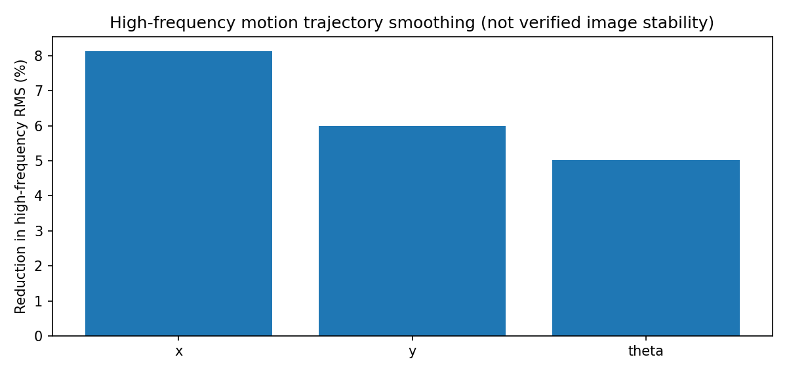
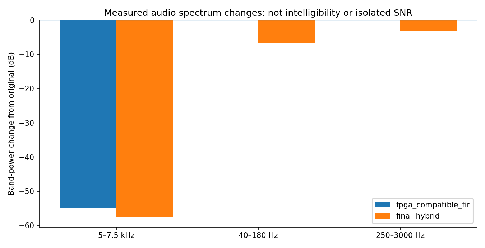

# Three-second maritime audiovisual sample — quantified processing outcome

**Sample:** `videos/03_Unified_Quick_Test_3s.mp4`, 90 frames at 30 fps,
16-kHz mono extracted audio (48,000 samples). **Evidence level:** **SOFTWARE
REFERENCE ONLY**, using the FPGA-compatible signed fixed-point FIR and the
host's existing warping and adaptive spectral cleanup. Reproducible JSON and
CSV/plots: `evidence/quality_2026-11-23_reference/` and `docs/figures/`.

## Video: what is (and is not) measured

| Metric | Measured result |
|---|---:|
| High-frequency X trajectory smoothing | 8.14% |
| High-frequency Y trajectory smoothing | 5.99% |
| High-frequency roll/θ smoothing | 5.02% |
| Geometric image area retained after crop | 92.46% |
| Independent image-content stability | **INCONCLUSIVE** |

The independent masked-background phase-correlation test found insufficient
natural background texture in this clip. The displayed trajectory metrics
measure smoothness of **estimated motion parameters**, not residual camera
shake visible in the rendered frames. Stronger smoothing can introduce crop
loss or obstruct intended pans; no 30% stabilisation target was achieved on
this short clip. More representative footage is needed before a visually
successful outcome can be claimed.



## Audio: spectral-band power change relative to original

| Processing stage | 5–7.5 kHz | 40–180 Hz | 250–3000 Hz |
|---|---:|---:|---:|
| **17-tap FIR only** (software bit-exact model) | −54.94 dB | 0.00 dB | −0.09 dB |
| **FIR plus host-adaptive noise cleanup** | −57.60 dB | −6.66 dB | −3.07 dB |

Negative change is an attenuation of the total signal energy in that band.
It is **not** automatically improved SNR: vocal components and noise may
coexist within the same frequencies. The speech band itself loses about
3.07 dB in the combined process. This must be listened to and assessed using
better reference recordings; it is not proof of superior speech clarity.



The user's **separate physical FPGA** audio/video run on 23 November reported
5–7.5 kHz −57.5 dB, rumble −6.77 dB, and speech band −3.01 dB in the combined
hybrid processing. These are operator-reported physical-pipeline metrics, not
recomputed from its original WAV/MP4 in this package; those output files were
not supplied. Similar numeric values are consistent with bit-exact FIR
processing but should not be treated as independent perceptual validation.

## Reproduce from a completed media run

Run software processing without a board:

```powershell
python .\host\unified_pipeline.py --video .\videos\03_Unified_Quick_Test_3s.mp4 --out .\videos\sim\quality_trial --audio-cleanup "Maritime adaptive"
powershell -ExecutionPolicy Bypass -File .\scripts\run_media_quality.ps1 -RunDir .\videos\sim\quality_trial
```

For the actual physical combined pipeline, run the existing hardware
verification script on the programmed Arty A7, then point
`run_media_quality.ps1` at its output directory containing `metrics.json`
plus WAVs. The tool explicitly distinguishes hardware-verified and software
runs based on the pipeline's recorded provenance. No bitstream rebuild is
necessary for those host-side assessments.

## Engineering caveats

- No independent reference camera pose, no isolated ground-truth noise track,
  no PESQ/STOI or blinded listener data: no invented SNR/intelligibility numbers.
- Low-texture scenes return `INCONCLUSIVE` rather than a fabricated visual
  improvement percentage.
- FIR low-pass and host spectral denoiser are separate stages; neither is
  itself a full real-time frame-processing FPGA design.
- All reported metrics apply only to the named three-second example, with
  stage-specific provenance. They are not universal maritime conditions.
