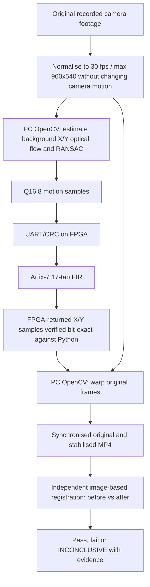

# Real-Footage Validation — FPGA Maritime Motion Stabilisation (GUI v0.5)

**Engineering status, 17 November 2026:** The Arty A7 UART/FIR path has previously passed physical bit-exact testing on COM4 (user-provided console evidence). This v0.5 **GUI real-footage path has been software-tested**; real naturally shaky video has **not** yet been tested on that board. Never label a software test or synthetic motion as this real-footage gate passing.

## Why this test is different

The controlled animation and injected-shake cases prove FIR arithmetic but cannot establish that the system estimates and corrects **naturally occurring** maritime camera shake. For a credible application evaluation, the input needs to be a video *recorded* with a genuinely moving camera (preferably on a vessel). No manual trajectory CSV or artificial camera transform may be inserted into that input.

## Processing partition

Only the numeric FIR, UART and buffering run in the FPGA. The PC estimates motion, reconstructs images, draws graphs and measures motion. This is a buffered offline demonstrator, **not** a real-time camera input/HDMI pipeline.

## How to run on your verified Arty A7-35T

1. Program the existing verified `arty_a7_maritime_top.bit` in Vivado Hardware Manager after power-up. Device `xc7a35t_0`, check configuration succeeds. The GUI cannot program JTAG.
2. In the new GUI click **Detect COM ports** and select the board (COM4 was confirmed for the development PC; it may differ).
3. Run **Verify FPGA connection & FIR**, expecting 3/3 bit-exact cases PASS.
4. Click **Import natural footage…**. Choose the **original recorded file** (`.mp4`, `.mov`, `.avi`, `.m4v`, `.webm`, `.mkv`). Select starting time; the tool exports up to 5 seconds at 30 fps and 960×540.
5. The tool records **SHA-256 of the original**, original frame rate, time range and transformations. It does **not** alter camera movement or attach a trajectory CSV.
6. Click **Stabilise Video Using FPGA**. Inspect the side-by-side playback and **Independent image jitter** tab, not only the FIR trajectory curves.
7. Use **Open result folder** and retain `source_provenance.json`, `estimated_camera_trajectory.csv`, `filtered_trajectory.json`, `metrics.json`, `motion_comparison.csv`, `motion_curves.png`, `motion_spectrum.png`, `image_stability_check.png`, `RUN_REPORT.md` and `fpga_before_after.mp4`.

The `Open video` button also accepts previously prepared 30fps clips, but **Import natural footage** is the recommended way to preserve a source checksum and make the conversion traceable.

## What to measure / how to interpret it

| Criterion | Gate / interpretation |
|---|---|
| Provenance | User-supplied recorded footage, no injected shake or CSV; original SHA-256 stored. Actual source authenticity/rights must be checked separately. |
| Numeric FPGA correctness | Every returned FIR output bit-exact against Python before physical hardware label is permitted. |
| Estimated motion | X/Y high-frequency trajectory RMS before vs after filtering. This metric is **not** independent image stabilisation evidence. |
| Independent image-content check | Separate background-masked Fourier phase-correlation on output frame pixels, reporting before/after high-frequency registration RMS and change %. |
| Inconclusive handling | If insufficient background image texture or too many bad registrations, report `INCONCLUSIVE` and **do not claim visual improvement**. |
| Negative outcomes | If the independent metric is worse, retain the negative result. Do not silently replace the original video or use a manual trajectory CSV. |
| Limits | Translation X/Y only; roll, strong pitch/perspective, motion blur, waves, independently moving ships and parallax may cause unsuccessful stabilisation. |

**Critical:** A reduction in motion-trajectory RMS can be large even when the original video looks poor. We therefore report the independent image metric separately, with quality gates. Neither metric by itself establishes human-perceived video quality.

## Sources for genuine vessel-mounted recordings

- [MODD2 dataset (ViCoS Laboratory)](https://data.vicos.si/borja/viamaro/index.html) — 28 real vessel video sequences (11,675 stereo-frames). Two sequences are documented as having sudden movement/boat rolling and pitching. The full raw video data archive is approximately **6 GB**; obtain it only when appropriate. Confirm archive redistribution and commercial-use permissions before publishing clips. The dataset is intended for marine obstacle detection, not specifically camera stabilisation.
- [Wikimedia Commons: Ocean Observatories Initiative maritime videos](https://commons.wikimedia.org/wiki/Category:Ocean_Observatories_Initiative_videos) — includes short research-vessel recordings such as `Irminger Bow in Waves (OOI).webm` and `Irminger waves without sound (OOI).webm`. Confirm the **individual file's licence and whether the camera actually shakes**. Wave motion in the scene is not the same as camera motion; reject clips that do not meet the test requirement.

No third-party footage is bundled with this package. Avoid reusing footage in a public portfolio if permission is uncertain.

## v1.0 real-footage release gate

- [ ] Source recorded on moving ship/boat and natural camera shake independently observed; original licensing and checksum recorded.
- [ ] 30fps import performed **without shake injection** or CSV substitution.
- [ ] OpenCV estimates camera X/Y without using known motion ground truth.
- [ ] FPGA return samples match Python **bit-for-bit**.
- [ ] Two same-source videos shown synchronously side-by-side.
- [ ] Independent image-based metric reports valid measurement, including an actual improvement to justify a positive claim, or explicitly declares FAIL/INCONCLUSIVE.
- [ ] Technical limitations, software/hardware responsibilities and evidence are disclosed in release README.

Until these are checked using a genuine recording, the real-video demonstration must remain **UNVERIFIED**.
