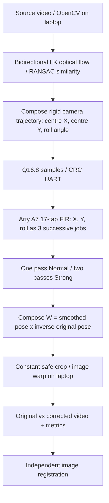

# Three-Axis Maritime Stabilisation — v0.7 Development Candidate

**Status:** Python/geometry development and Linux software tests completed; **clean Windows Vivado/XSim and physical GUI-to-Arty A7 verification pending**. This is not yet a final, real-world-validated release.

## Why the original and corrected videos sometimes look identical

The v0.6 estimator reported just translation. It also used the translation column of a fitted affine map, which includes apparent translation from rotation around the camera centre. It ignored roll when reconstructing frames. A correctly filtered FIR trajectory therefore need not produce an obviously improved video.

## Updated architecture



**FPGA work:** only the numeric FIR (already checked bit-exact on its earlier serial protocol). The existing FPGA bitstream, RTL, UART format, 17-tap coefficients and Vivado project can be reused **without reprogramming for the algorithm change**, provided that the correct Artix-7 design is already loaded. Three axes are three independent batch jobs (job IDs 1, 2, 3). Strong repeats the filter for each axis using job IDs 4, 5, 6. The Python bit-exact comparison runs for **every FPGA job**; a failed comparison stops processing and prevents a hardware-verified label. The existing board design still needs validation with these additional job sequences.

### Correct image geometry

For frame-to-frame motion `M_i`, compose `C_i = M_i C_(i-1)` in image coordinates, suppress similarity *scale* and extract:

- Image-centre horizontal displacement `x_i`
- Image-centre vertical displacement `y_i`
- Accumulated image-plane rotation `theta_i` in degrees

Do **not** sum the affine translation columns; the centre moves under rotation. Construct original camera transform `C_i` and filtered target transform `S_i` from those centre-relative paths. Correct each source frame with `W_i = S_i C_i^(-1)`.

`theta_i` is quantised as **degrees in signed Q16.8**. Its numerical filtering uses the same 24-bit input, 16-bit Q1.15 coefficients, and bit-exact 17-tap reference. The Python host converts filtered angles to radians for image transforms. Rotation angles are accumulated from consecutive small frame-to-frame rotations; sequences are limited to short offline clips.

### Motion confidence

Track sparse image features forward **and backward** and reject tracks with >1.6 px round-trip displacement. Estimate a similarity transform with RANSAC; accept its rotation only if inlier ratio >=0.42 and estimated rotation <12 degrees/frame. Otherwise fall back to robust median translation or hold the previous pose, recording every fallback. These gates are pragmatic starting thresholds, not maritime-certified values. Water, waves and moving ships are still difficult; LOW-confidence results require careful review and may be inaccurate despite passing the thresholds. Detecting and rejecting hard scene cuts is future work.

### Smoothing profiles

| Profile | FPGA jobs | Model |
|---|---|---|
| Normal | 3 | One 17-tap FIR pass on X, Y and roll |
| Strong | 6 | Two successive 17-tap FIR passes on X, Y and roll |

Strong filtering removes more high-frequency motion but increases the chance of suppressing intentional camera movement or requiring larger crops. Profiles are software-controlled without changing the coefficients stored in FPGA RTL.

### Edge handling and fidelity

A *single global crop* is computed by checking the transformed frame-corner geometry for all frames. If that crop exceeds a safe configured limit, the output retains reflected image boundaries and reports a warning instead of silently hiding missing pixels. The same fixed crop is applied to original and corrected comparisons, avoiding a moving zoom. Cropped video is rescaled for a common display size, so the cost in retained field of view is stated as a percentage. This is not lens/rolling-shutter compensation.

### Output and validation

- `fpga_before_after.mp4` on physical hardware, `software_preview_before_after.mp4` on Python-only mode
- `estimated_camera_trajectory.csv`: X, Y, roll with Q16.8 and floating-view columns
- `motion_estimation_diagnostics.json`: every frame's RANSAC inlier ratio, feature count and fallbacks
- `filtered_trajectory.json`: all 3 filtered axes
- `roll_comparison.png`, `motion_curves.png`, `motion_spectrum.png`
- `metrics.json` with filtered-axis reduction, crop area, profile, independent image stability result and IMPROVED/WORSE/INCONCLUSIVE classification
- `RUN_REPORT.md`, and other existing GUI evidence files

An improvement in numeric trajectory RMS is **not** proof that video quality improved. The independent image registration may say MEASURED improvement, MEASURED deterioration, or INCONCLUSIVE, depending on texture and reliability. This test does not offer scientific proof of ship target-lock performance.

## Fresh Windows test (Arty A7-35T)

1. Download **the `feature/three-axis-v0.7` branch**, not `main` or older `integration-v0.6`, into a new directory such as `C:\FPGA\maritime_v07`.
2. Install requirements, run regression, and launch GUI:

   ```powershell
   python -m pip install -r .\host\requirements.txt
   powershell -ExecutionPolicy Bypass -File .\scripts\run_gui_tests.ps1
   powershell -ExecutionPolicy Bypass -File .\scripts\launch_maritime_gui.ps1
   ```

3. Program the existing `arty_a7_maritime_top.bit` if the board was power-cycled. Rebuild in Vivado if the bitstream is not present. Select the actual UART port (COM4 in prior testing).
4. Click **Verify connection & FIR**. Select **Strong** or **Normal**. Load an original compatible clip with **Open video** (no CSV); click **Stabilise using FPGA**.
5. Inspect video, **Roll** chart, image stability, RANSAC warnings, correction magnitude and crop percentage. Retain negative outcomes.

### CLI host test without board

```powershell
python .\host\run_v07.py --video .\myclip.mp4 --out .\build\v07_trial --profile Strong
```

Add `--port COM4` only when the board is programmed. Omit the port for a clearly labelled software-reference test.

## Reproducible software trial of three candidate AI-generated maritime clips

The following are **software-reference measurements**, not physical FPGA runs or real filmed sea trials. Clips are derived from the user-supplied AI-generated maritime sources. Same 30 fps / 5s files were tested in the v0.7 pipeline (Strong). Numbers are not directly comparable with older v0.6 ratings because geometry and global crop were changed.

| Clip | Numeric X reduction | Numeric Y reduction | Numeric roll reduction | Independent image jitter | Cropped area retained |
|---|---:|---:|---:|---:|---:|
| Video 4 (cargo ship) | 36.9% | 33.2% | 30.2% | +89.2% reduction | 89.1% |
| Video 6 (heavy seas) | 13.6% | 7.9% | 14.7% | +47.5% reduction | 88.2% |
| Video 7 (storm) | 3.7% | 13.6% | 8.3% | **−74.9% (worse)** | 95.4% |

**Important:** The negative Video 7 result is retained. Stronger filtering and roll compensation do not automatically improve every scene. The next investigation should focus on separating target/wave motion from true camera movement, and on better handling cuts, severe camera pitching and poor registration.

## Acceptance conditions

- [x] v0.7 software tests and synthetic rotation geometry verification pass on development host
- [x] v0.7 software pipeline exercised with three maritime candidates and all outcomes recorded
- [ ] New GUI software runs correctly on Windows, including Roll plots and Strong mode
- [ ] Normal and Strong physically processed, X/Y/roll bit-exact over COM4
- [ ] Naturally recorded, licensed, visibly shaky ship footage validated with independent image-based metrics
- [ ] Vivado route/DRC history signed off for a final hardware portfolio release

The existing FPGA implementation remains an earlier verified bitstream; no new routed hardware has been measured in this v0.7 effort.
