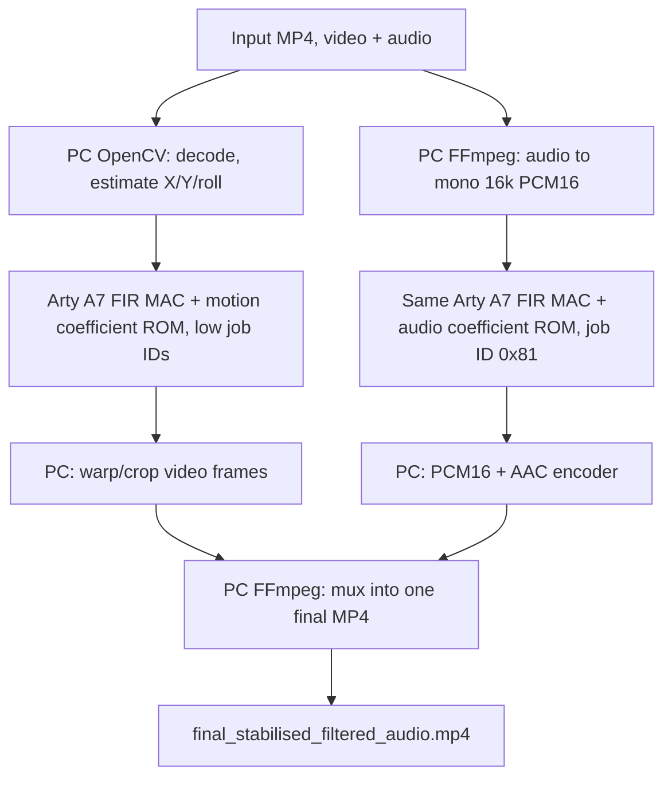

# Unified Maritime Video + Audio FIR — v1.0 development candidate

**Status (20 November 2026):** One-source software audio/video processing implemented and tested in Python; the physical combined FPGA processing gate has **NOT** passed locally. This extension is based on the new dual-bank v0.9 RTL, not the previous video-only bitstream. GitHub `main` remains the last working video baseline.

## Engineering goal

Upload one MP4 containing both shake and an unwanted audio component; the demonstrator estimates camera X/Y/roll, FIR-filters the trajectories, reconstructs steadier frames, FIR-filters its 16 kHz mono soundtrack with a separate speech-band coefficient ROM, and exports **one combined MP4** with the stabilised video and the filtered audio. Files are saved under `videos/sim` for software or `videos/hrd` for real FPGA measurements, not mixed with original inputs.

**This first audio filter suppresses out-of-band hiss rather than removing all noise.** A 3.2 kHz low-pass removes legitimate consonant energy and does not separate voice from engine/wind noise in the same speech frequencies. Do not claim "noise free" or "speech enhanced" without perceptual or reference-based evaluation.

## Hardware / host boundary



The FPGA receives **samples only**, not video pixels or audio samples through an external ADC. UART jobs are buffered; this is **offline** and can run far slower than real time. At 115200 baud, processing 30 seconds of 16 kHz audio requires hundreds of bidirectional packets, with a raw serial-transfer lower bound of several minutes before host/codec overhead. A high-throughput audio interface is a future extension.

## GUI behaviour

Three tabs remain: **Implementation**, **Assessment** and **Help**. `Processing` selects `Video + Audio` or `Video only`. The GUI selects the combined mode automatically when loading a source with an audio track, and uses video-only when there is no soundtrack. `Software preview` tests the chosen path without physical hardware. `Process using FPGA` uses the currently selected COM port, with bit-exact return verification for **both** coefficient banks. `Verify FPGA` tests three motion jobs plus the audio bank in combined mode, to catch old firmware before a long transfer.

The Tk video panels remain **silent**. **Play MP4 with audio** opens the exported MP4 in the system player with the new filtered soundtrack. For original-vs-processed audio listening, use `audio_original.wav`, `audio_filtered.wav` or `audio_AB_compare.wav` in the result folder. The side-by-side MP4 has **one** filtered soundtrack, not separate left/right sound. Audio-only investigation remains at File → Audio noise reduction.

## Evidence per combined run

- `final_stabilised_filtered_audio.mp4`: right-hand stabilised video **with filtered AAC soundtrack**.
- `software_preview_before_after.mp4` or `fpga_before_after.mp4`: side-by-side motion comparison, with filtered soundtrack.
- `audio_original.wav`, `audio_filtered.wav`, `audio_AB_compare.wav`, `audio_analysis.png`.
- `metrics.json`, `combined_metrics.json`, `RUN_REPORT.md`, motion trajectories, filtered trajectories, image stability and plots.
- Measured image-jitter improvement is independent of FIR arithmetic correctness; one positive metric does not imply all footage is stabilisable.
- Audio band-power reduction is not a speech intelligibility metric; a clean reference is needed for reference-based audio-quality scores.

## Windows tests — software now

Extract the source into a fresh directory and open PowerShell at the project root:

```powershell
python -m pip install -r .\host\requirements.txt
powershell -ExecutionPolicy Bypass -File .\scripts\run_gui_tests.ps1
powershell -ExecutionPolicy Bypass -File .\scripts\launch_maritime_gui.ps1
```

Start with `videos/03_Unified_Quick_Test_3s.mp4`, choose **Video + Audio**. The supplied longer source `videos/02_Maritime_Long_30s_With_Audio.mp4` is a later, slow endurance case. For either one, choose **Video + Audio** and **Software preview**. Open Assessment, inspect both processing labels, then use **Play MP4 with audio**. The longer source has several scene changes and is not guaranteed to show meaningful visual improvement. First use a short video/audio sample for a controlled listening comparison.

CLI equivalent:

```powershell
powershell -ExecutionPolicy Bypass -File .\scripts\run_unified_demo.ps1
```

## Hardware gate — pending

The old v0.8.2 bitstream does **not** contain the audio coefficient bank. Rebuild and program the current v0.9+ RTL before using `Video + Audio` with physical hardware:

```powershell
& 'C:\AMDDesignTools\2025.2.1\Vivado\bin\vivado.bat' -mode batch -source scripts/build_maritime_bitstream.tcl
```

Review routed timing/DRC/resource usage, program `arty_a7_maritime_top.bit` through Hardware Manager, choose the actual COM port (previously COM4), click **Verify FPGA**, then process a **short audio+video clip** in physical mode. Bit-exact audio/trajectory checks must pass. Longer media is an offline endurance/performance test that may take several minutes. A missing COM port or failed audio-bank selection is an explicit failure, **never** a software fallback.

## Verification status

- [x] Existing 17-tap motion and speech-band audio numerical filters preserve separate coefficient banks.
- [x] Software unified video/audio export from one MP4, with AAC and WAV checks.
- [x] Mock-UART dual-bank bit-exact and wrong-coefficient negative tests.
- [x] Regression suite and GUI desktop execution in development environment.
- [ ] Fresh Windows software build and 30-second full combined test on user machine.
- [ ] Vivado synthesis, routing/timing/DRC for dual-bank audio design.
- [ ] Physical COM-port video + audio processing and bit-exact end-to-end validation.
- [ ] Human listening tests and actual voice/noise measurement on recorded maritime footage.

## Windows AAC packet-duration regression (v1.0.1)

On 20 Nov 2026, a Windows FFmpeg decode returned **14,976** samples for a 1-second AAC test source (expected 16,000 at 16 kHz), missing exactly one AAC packet (1,024 samples). The unified regression previously required at least 15,600 samples, causing a false assumption that every decoder returns precisely one second. An actual short audio track can also cause a mux with `-shortest` to cut video frames.

The updated combined pipeline calculates the expected audio sample count from `video_frame_count / video_fps`, **pads only the missing end with silence**, or trims excess, and saves `decoded_audio_samples`, `audio_end_silence_padding_samples` and `audio_end_trimmed_samples` in the exported metrics. It never invents content in the missing portion. A regression injects the Windows-style one-packet AAC shortfall and checks preserved 30-frame video length and 16,000-sample WAV duration. This alters **host code only**, not FPGA coefficients or hardware RTL.

The correction passed a full 58-test regression (with a virtual display), including the new short-AAC test. It still requires the user's Windows validation. The physical v0.9 dual-bank FPGA build and COM-port test remain pending.
